# A7 – Bracket Finite Element Analysis and Optimization

## Objective

The objective of this assignment was to use **finite element analysis (FEA)** to evaluate and improve the bracket developed in A5 and A6. The design was evaluated for strength, stiffness, safety factor, and mass while keeping the original **ASTM A36 steel** material.

The optimization used two loops:

- **Outer loop:** modify the bracket geometry to create three different designs.
- **Inner loop:** refine the finite element mesh for each design until the results changed by less than **7%**, or until the third mesh attempt was completed.

The main results recorded for each design were:

- Maximum von Mises stress
- Maximum displacement
- Minimum factor of safety
- Mass
- Number of elements
- Location of the maximum stress and displacement

---

# FEA Setup

## Material and Loading

The same ASTM A36 steel used in the previous bracket design was retained.

| Parameter | Value |
|---|---:|
| Material | ASTM A36 Steel |
| Applied load | 1300 lbf |
| Load direction | Vertically downward |
| Load location | Upper curved surface of cylinder |
| Mesh type | Blended curvature-based solid mesh |
| Mesh quality | High |
| Convergence criterion | 7% |

The bracket was constrained on the lower faces of the two upper arms where the bracket contacts the supporting T-beam.

> **Figure A7-1 — Fixed geometry used for the static simulations**

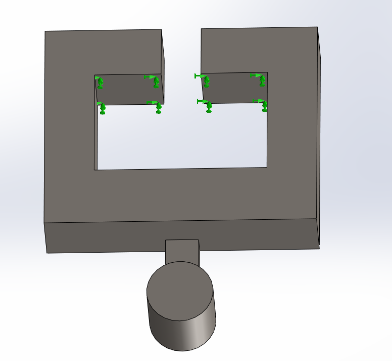

The 1300 lbf strap load was applied to the upper curved portion of the cylinder. A selected-direction force was used so that the load acted vertically downward rather than normal to the curved surface.

> **Figure A7-2 — 1300 lbf downward load applied to the cylinder**

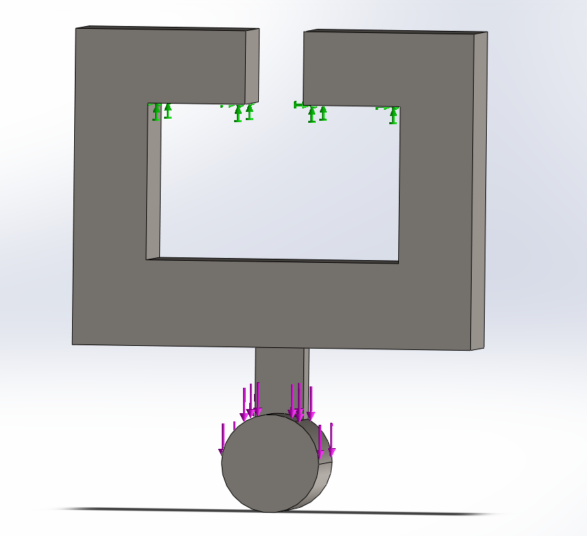

---

# Design I — Baseline Bracket

Design I used the original bracket geometry from A5/A6 without geometric optimization. This provided the baseline FEA results used to determine where the bracket should be improved.

The original front-view width of Feature B was:

$$
w_B=0.498\text{ in}
$$

and its thickness remained:

$$
T_B=0.375\text{ in}
$$

## Initial Results

The first simulation used the default blended curvature-based mesh.

| Mesh | Max Element Size | Min Element Size | Elements |
|---|---:|---:|---:|
| Mesh 1 | 0.212024 in | 0.212024 in | 9,073 |
| Mesh 2 | 0.150 in | 0.075 in | 26,231 |
| Mesh 3 | 0.100 in | 0.050 in | 78,607 |

The first mesh predicted a maximum von Mises stress of:

$$
\sigma_{\max}=6.209\times10^8\text{ Pa}
$$

The highest stress was concentrated around the **Feature B-to-cylinder connection**.

> **Figure A7-3 — Design I Mesh 1 von Mises stress**

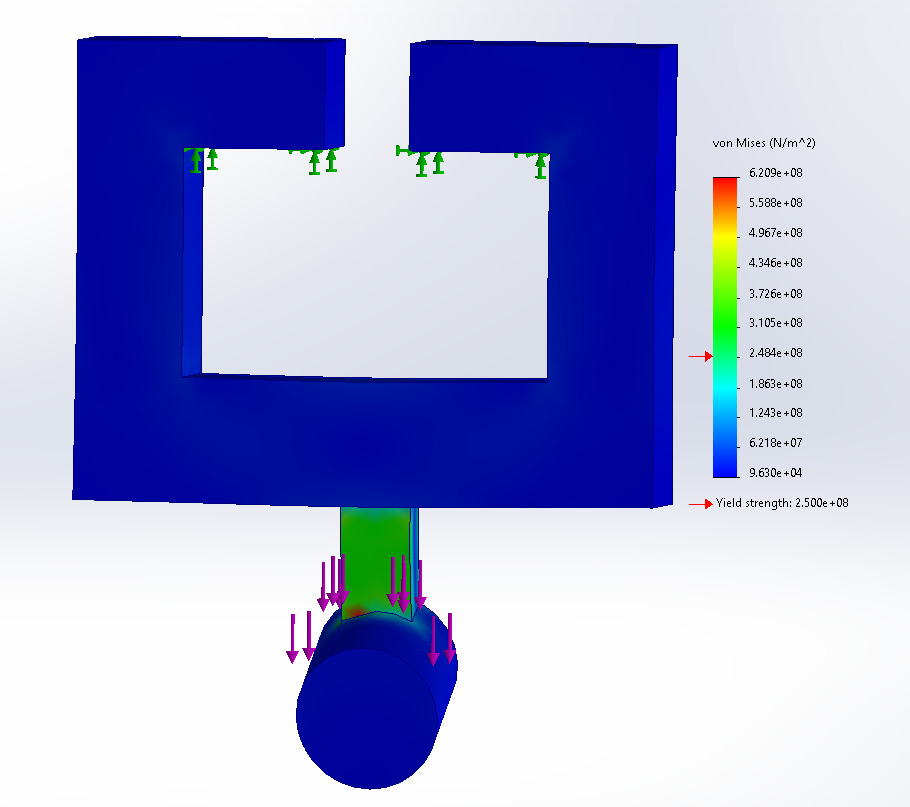

The initial minimum factor of safety was:

$$
N_{\min}=0.4027
$$

> **Figure A7-4 — Design I Mesh 1 factor of safety**

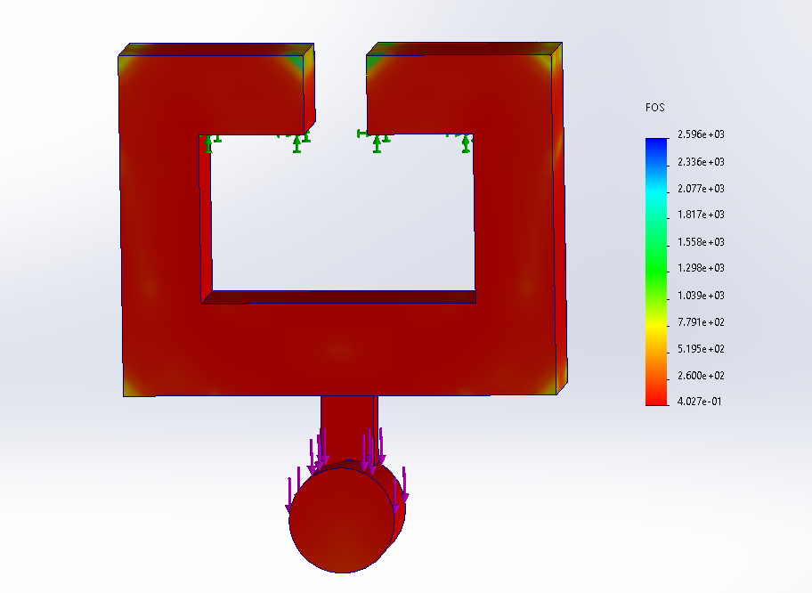

The initial maximum displacement was:

$$
\delta_{\max}=0.2893\text{ mm}
$$

with the largest displacement occurring near the free end of the cylinder.

> **Figure A7-5 — Design I Mesh 1 displacement**

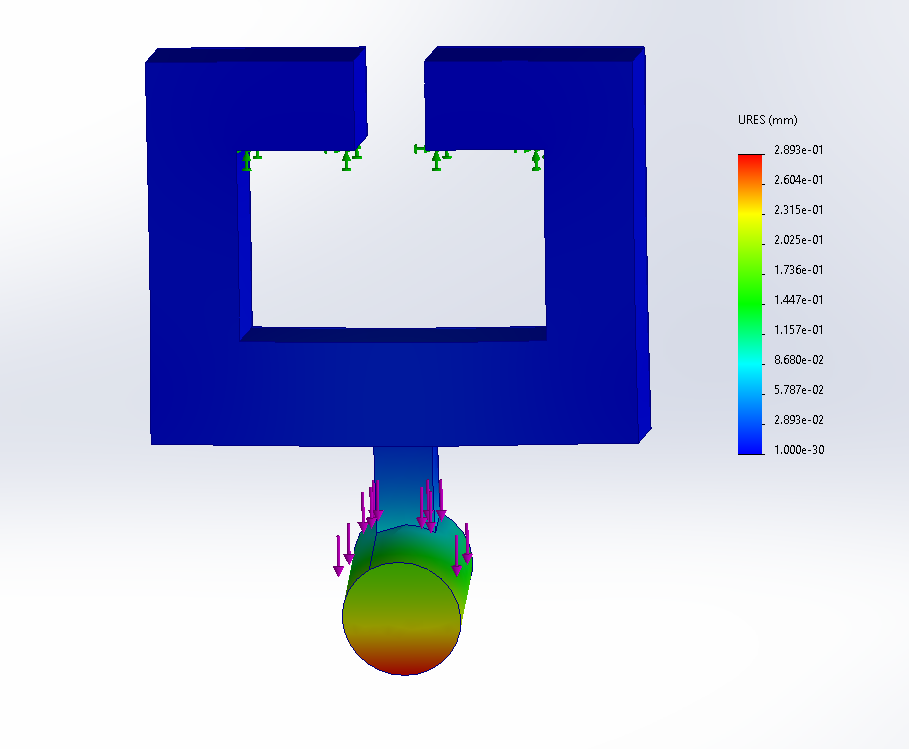

---

## Design I Inner Mesh Loop

Mesh convergence was evaluated using:

$$
\%\text{ Change}
=
\frac{|\text{Previous}-\text{New}|}
{\text{New}}
\times100
$$

### Mesh Results

| Result | Mesh 1 | Mesh 2 | Mesh 3 |
|---|---:|---:|---:|
| Elements | 9,073 | 26,231 | 78,607 |
| Max Stress | 620.9 MPa | 548.1 MPa | 608.1 MPa |
| Max Displacement | 0.2893 mm | 0.2933 mm | 0.2964 mm |
| Minimum FOS | 0.4027 | 0.4561 | 0.4111 |

### Mesh 1 → Mesh 2

Stress convergence:

$$
\frac{|620.9-548.1|}{548.1}(100)
=
\boxed{13.28\%}
$$

Displacement convergence:

$$
\frac{|0.2893-0.2933|}{0.2933}(100)
=
\boxed{1.36\%}
$$

Factor-of-safety convergence:

$$
\frac{|0.4027-0.4561|}{0.4561}(100)
=
\boxed{11.73\%}
$$

Stress and factor of safety had not yet converged, so the mesh was refined again.

### Mesh 2 → Mesh 3

Stress convergence:

$$
\frac{|548.1-608.1|}{608.1}(100)
=
\boxed{9.87\%}
$$

Displacement convergence:

$$
\frac{|0.2933-0.2964|}{0.2964}(100)
=
\boxed{1.05\%}
$$

Factor-of-safety convergence:

$$
\frac{|0.4561-0.4111|}{0.4111}(100)
=
\boxed{10.96\%}
$$

The displacement result converged, but the stress and factor of safety remained above the 7% criterion. Because this was the **third mesh attempt**, the assignment procedure required the finer Mesh 3 results to be used for the final Design I values.

## Final Design I Results

> **Figure A7-6 — Design I final Mesh 3 von Mises stress**

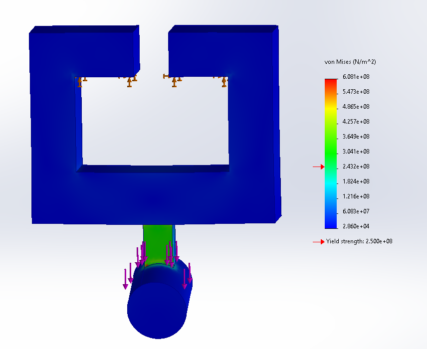

> **Figure A7-7 — Design I final Mesh 3 displacement**

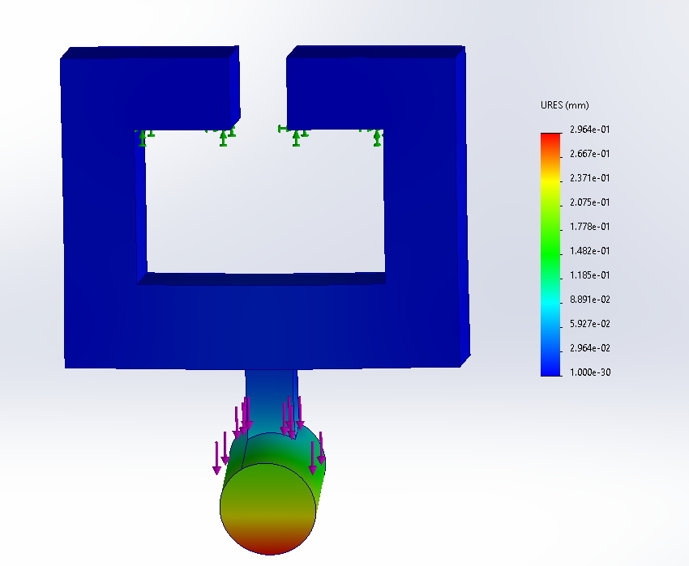

> **Figure A7-8 — Design I final Mesh 3 factor of safety**

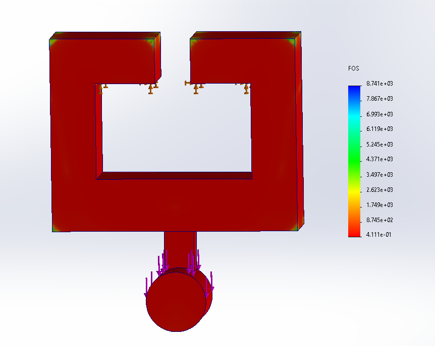

The final Design I results were:

- **Maximum stress:** 608.1 MPa
- **Maximum displacement:** 0.2964 mm
- **Minimum FOS:** 0.4111
- **Mass:** 2.70 lb
- **Elements:** 78,607

The high stress near Feature B showed that this region was the most important location to modify in the next outer-loop design.

---

# Design II — Wider Feature B

The first geometry optimization increased the **front-view width of Feature B** from:

$$
0.498\text{ in}
\rightarrow
0.625\text{ in}
$$

The axial thickness remained:

$$
T_B=0.375\text{ in}
$$

Keeping the 0.375 in thickness was important because increasing this dimension would reduce the usable cylinder length available for the 3/4 in strap. Increasing the front-view width instead added material directly to the load path without reducing strap clearance.

> **Figure A7-9 — Design II with Feature B increased to 0.625 in**

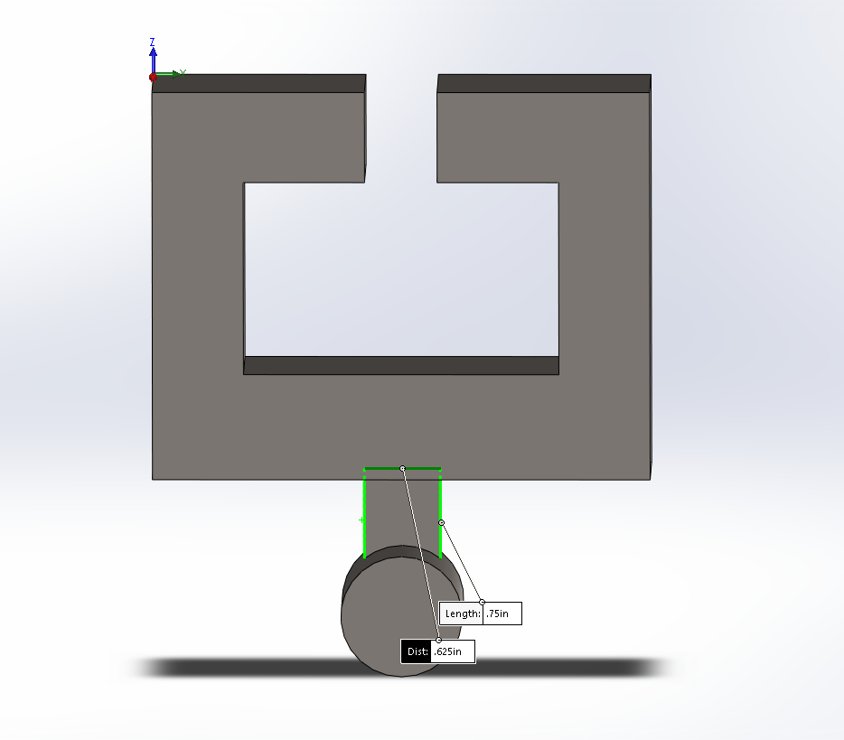

---

## Design II Inner Mesh Loop

| Result | Mesh 1 | Mesh 2 |
|---|---:|---:|
| Elements | 9,350 | 26,636 |
| Max Stress | 331.5 MPa | 352.8 MPa |
| Max Displacement | 0.2323 mm | 0.2362 mm |
| Minimum FOS | 0.7541 | 0.7087 |

### Mesh 1 → Mesh 2

Stress convergence:

$$
\frac{|331.5-352.8|}{352.8}(100)
=
\boxed{6.04\%}
$$

Displacement convergence:

$$
\frac{|0.2323-0.2362|}{0.2362}(100)
=
\boxed{1.65\%}
$$

Factor-of-safety convergence:

$$
\frac{|0.7541-0.7087|}{0.7087}(100)
=
\boxed{6.41\%}
$$

All three values changed by less than 7%, so **Design II converged after Mesh 2** and did not require a third refinement.

## Final Design II Results

> **Figure A7-10 — Design II final Mesh 2 von Mises stress**

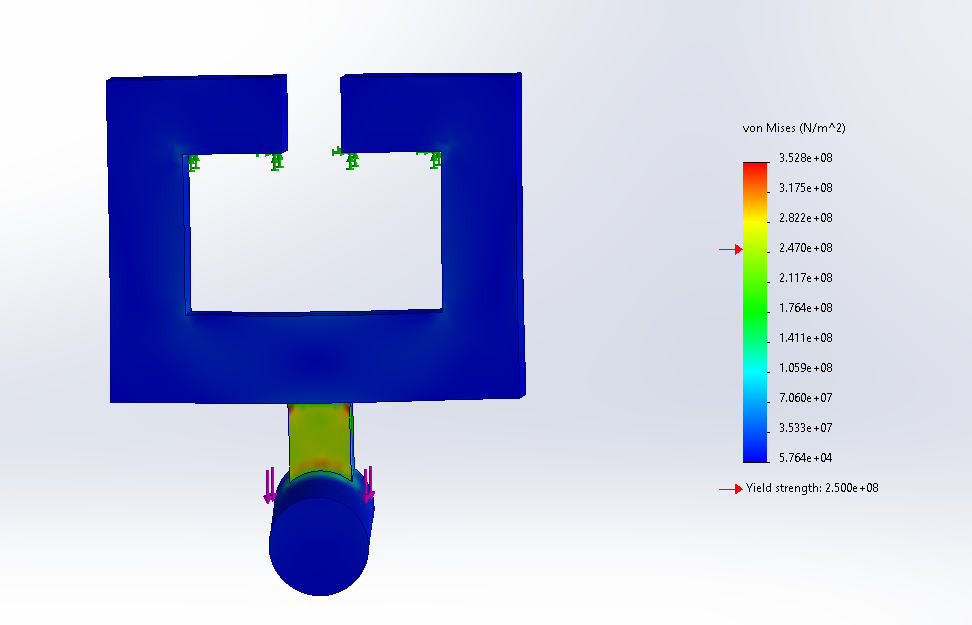

> **Figure A7-11 — Design II final Mesh 2 displacement**

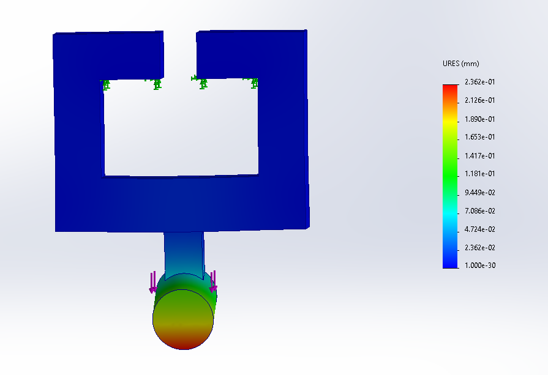

> **Figure A7-12 — Design II final Mesh 2 factor of safety**

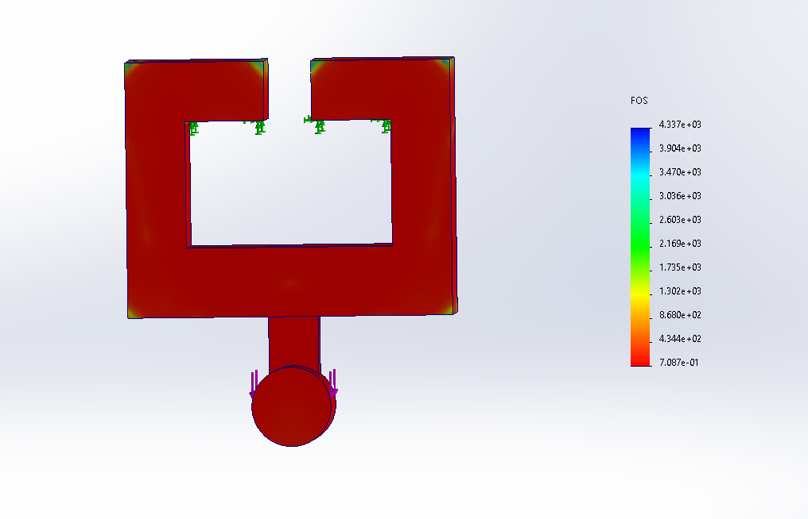

The final Design II results were:

- **Maximum stress:** 352.8 MPa
- **Maximum displacement:** 0.2362 mm
- **Minimum FOS:** 0.7087
- **Mass:** 2.71 lb
- **Elements:** 26,636

Compared with Design I, the Feature B width increase reduced the final peak stress by approximately:

$$
\frac{608.1-352.8}{608.1}(100)
=
\boxed{42.0\%}
$$

The maximum displacement was also reduced by approximately:

$$
\frac{0.2964-0.2362}{0.2964}(100)
=
\boxed{20.3\%}
$$

while the mass increased by only about 0.01 lb.

The Design II stress plot showed that the original cylinder-junction concentration had been reduced. The remaining highest stresses were concentrated more locally on the front face of Feature B near its sharp transitions into the surrounding bracket, with a smaller concentration near the cylinder.

---

# Design III — Filleted Feature B Transitions

Design III retained the wider Feature B from Design II and added fillets to the **upper and lower front transitions of Feature B**.

The purpose of this change was to reduce the sharp geometric transitions visible in the Design II stress plot and distribute the load more gradually into the surrounding bracket and cylinder.

---

## Design III Inner Mesh Loop

| Result | Mesh 1 | Mesh 2 | Mesh 3 |
|---|---:|---:|---:|
| Elements | 9,366 | 27,852 | 78,494 |
| Max Stress | 325.9 MPa | 367.1 MPa | 369.4 MPa |
| Max Displacement | 0.2148 mm | 0.2183 mm | 0.2189 mm |
| Minimum FOS | 0.7671 | 0.6811 | 0.6767 |

### Mesh 1 → Mesh 2

Stress convergence:

$$
\frac{|325.9-367.1|}{367.1}(100)
=
\boxed{11.22\%}
$$

Displacement convergence:

$$
\frac{|0.2148-0.2183|}{0.2183}(100)
=
\boxed{1.60\%}
$$

Factor-of-safety convergence:

$$
\frac{|0.7671-0.6811|}{0.6811}(100)
=
\boxed{12.63\%}
$$

Stress and factor of safety had not converged, so a third mesh was required.

### Mesh 2 → Mesh 3

Stress convergence:

$$
\frac{|367.1-369.4|}{369.4}(100)
=
\boxed{0.62\%}
$$

Displacement convergence:

$$
\frac{|0.2183-0.2189|}{0.2189}(100)
=
\boxed{0.27\%}
$$

Factor-of-safety convergence:

$$
\frac{|0.6811-0.6767|}{0.6767}(100)
=
\boxed{0.65\%}
$$

All three results were below the 7% criterion. Therefore, **Design III successfully converged at Mesh 3**.

## Final Design III Results

> **Figure A7-13 — Design III final Mesh 3 von Mises stress**

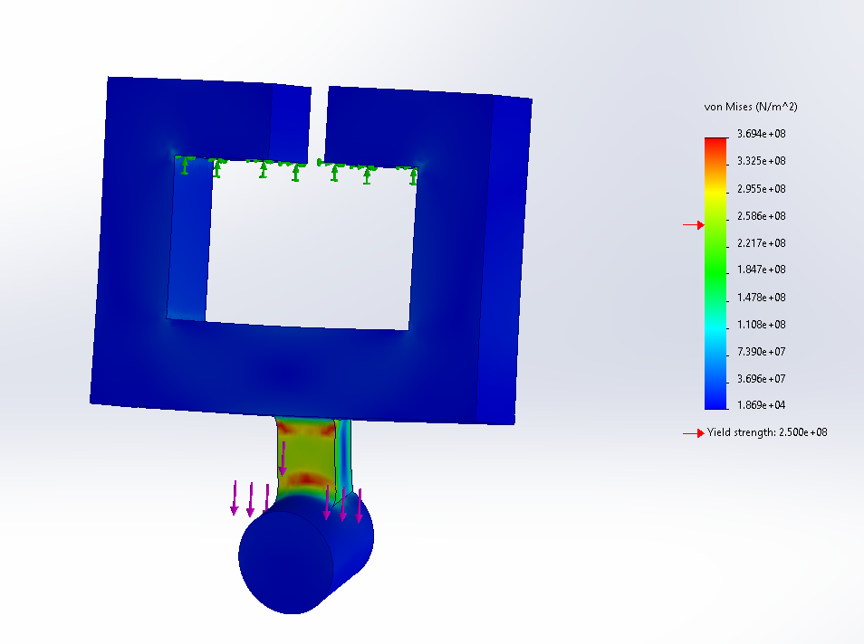

> **Figure A7-14 — Design III final Mesh 3 displacement**

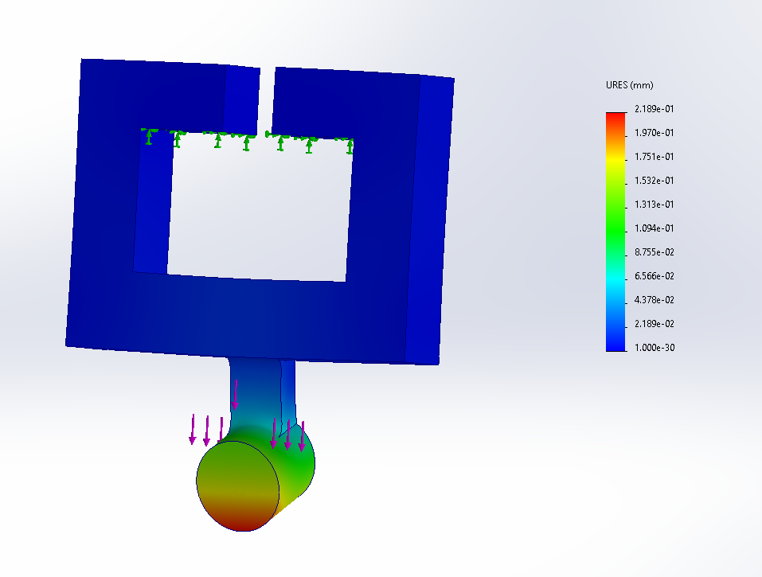

> **Figure A7-15 — Design III final Mesh 3 factor of safety**

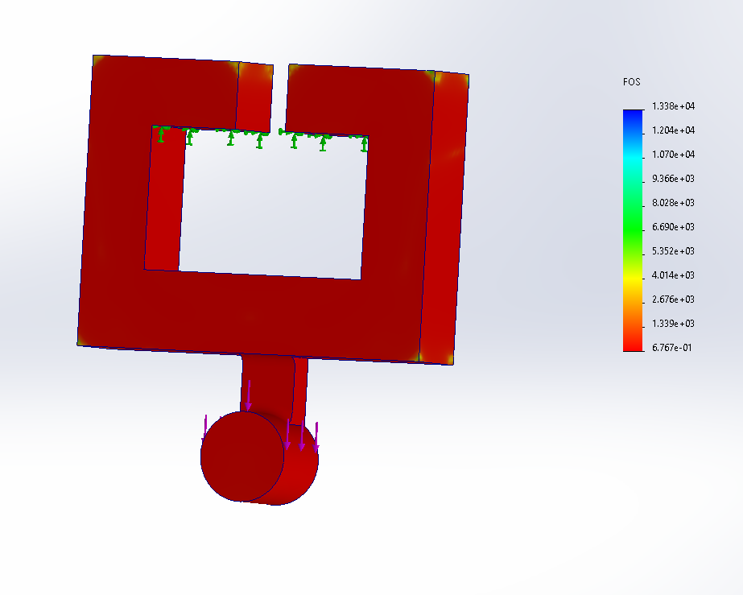

The final Design III results were:

- **Maximum stress:** 369.4 MPa
- **Maximum displacement:** 0.2189 mm
- **Minimum FOS:** 0.6767
- **Mass:** 2.71 lb
- **Elements:** 78,494

Design III produced the **lowest displacement of all three designs**, making it the stiffest design tested.

However, its maximum stress was slightly higher than Design II and its minimum factor of safety was slightly lower.

---

# Stress Distribution Comparison

The close-up stress plots show an important difference between Designs II and III.

> **Figure A7-16 — Design III stress distribution around Feature B**

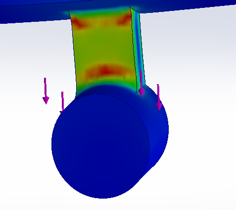

In Design III, the fillets caused the high-stress region to become **more distributed across the transition** rather than being concentrated into a very small location.

> **Figure A7-17 — Design II localized stress distribution around Feature B**

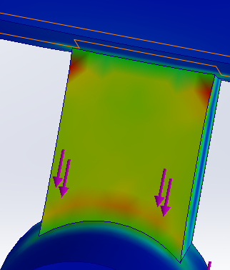

Design II had a more localized high-stress region near the sharp transitions of Feature B.

The fillets therefore changed the **distribution** of the stress as intended, but they did not reduce the final maximum stress. The converged peak stress increased from 352.8 MPa in Design II to 369.4 MPa in Design III.

At the same time, displacement decreased from 0.2362 mm to 0.2189 mm.

This means the fillets improved stiffness and spread the stress over a larger area, but did not improve the peak-stress result.

---

# Final Design Comparison

| Parameter | Design I | Design II | Design III |
|---|---:|---:|---:|
| Geometry change | Baseline | Feature B widened to 0.625 in | Feature B widened + filleted transitions |
| Max Stress | 608.1 MPa | **352.8 MPa** | 369.4 MPa |
| Max Stress Location | Feature B / cylinder junction | Front of Feature B near sharp transitions | Front of Feature B near filleted transitions |
| Max Displacement | 0.2964 mm | 0.2362 mm | **0.2189 mm** |
| Max Displacement Location | Cylinder free end | Cylinder free end | Cylinder free end |
| Mass | **2.70 lb** | 2.71 lb | 2.71 lb |
| Minimum FOS | 0.4111 | **0.7087** | 0.6767 |
| Final Elements | 78,607 | 26,636 | 78,494 |
| Inner-loop result | Third attempt used | Converged Mesh 2 | Converged Mesh 3 |

## Final Design Selection

Of the three designs tested, **Design II was selected as the best overall design**.

Design III was approximately 7.3% stiffer based on maximum displacement:

$$
\frac{0.2362-0.2189}{0.2362}(100)
=
\boxed{7.32\%}
$$

However, compared with Design II, Design III also increased the maximum stress by approximately:

$$
\frac{369.4-352.8}{352.8}(100)
=
\boxed{4.71\%}
$$

and reduced the minimum factor of safety.

Both designs had essentially the same mass of 2.71 lb.

For that reason, **Design II provided the better balance of strength, stiffness, and weight**. The simple increase in Feature B width produced a major improvement over Design I without significantly increasing the bracket mass.

---

# Safety Evaluation

Although Design II was the best of the three configurations, it should not be interpreted as a fully safe final bracket under the simulated loading.

The SolidWorks results indicate an ASTM A36 yield strength of approximately:

$$
S_y\approx2.50\times10^8\text{ Pa}
=
250\text{ MPa}
$$

The final Design II maximum stress was:

$$
\sigma_{\max}=352.8\text{ MPa}
$$

which produces:

$$
N_{\min}=0.7087<1
$$

All three tested designs had a minimum factor of safety below 1.

Therefore, the FEA predicts **local yielding under the modeled 1300 lbf load**. Design II represents the best design of the three iterations completed for this assignment, but additional geometry optimization would be required before treating the bracket as an acceptable elastic design at this loading condition.

---

# Lessons Learned

## Mesh Convergence Matters

One of the clearest results from this assignment was that displacement converged much faster than peak stress.

For example, Design I displacement changed by only 1.05% between Mesh 2 and Mesh 3, while the maximum stress still changed by 9.87%.

This demonstrated that a stable-looking deformation plot does not automatically mean that the stress solution has converged. Local stress concentrations can remain highly sensitive to element size.

## Small Geometry Changes Can Produce Large Improvements

Increasing Feature B from 0.498 in to 0.625 in only increased the total bracket mass from approximately 2.70 lb to 2.71 lb, but reduced the final maximum stress by approximately 42%.

This showed that adding material specifically to a critical load path can be much more effective than increasing material throughout the entire part.

## Fillets Do Not Automatically Reduce Peak Stress

The Design III fillets visually spread the stress over a larger region and reduced maximum displacement, but the converged peak stress was slightly higher than Design II.

This was an important result because it showed that an apparently smoother stress distribution does not necessarily mean that the numerical maximum stress has decreased.

Geometry changes need to be evaluated using the actual converged results rather than appearance alone.

## Optimization Requires Multiple Performance Measures

If displacement alone had been used to select the final design, Design III would have been selected because it was the stiffest.

If maximum stress and factor of safety are also considered, Design II becomes the better overall design.

The final decision therefore required comparing:

- Strength
- Stiffness
- Safety factor
- Mass
- Stress distribution

rather than optimizing only one result.

## FEA Can Reveal Behavior Missed by Simplified Hand Calculations

The analytical work from the previous bracket assignment treated individual features using simplified beam and axial-loading models. The FEA showed how the complete geometry transfers load between those features and revealed strong local stress concentrations around Feature B.

This demonstrated why analytical calculations and FEA are most useful when used together: hand calculations provide an initial design and physical understanding, while FEA can identify local behavior caused by the actual three-dimensional geometry.

---

# Conclusion

Three bracket designs were evaluated using static finite element analysis and repeated mesh refinement.

Design I established the baseline and revealed a large stress concentration around Feature B.

Design II increased the Feature B width from 0.498 in to 0.625 in and reduced the final peak stress by approximately **42%** while adding only approximately **0.01 lb** of mass.

Design III added filleted transitions to redistribute the stress and produced the lowest displacement, but its converged maximum stress was slightly greater than Design II.

Therefore:

$$
\boxed{\text{Design II was selected as the best of the three tested designs}}
$$

The final selected design had:

$$
\boxed{\sigma_{\max}=352.8\text{ MPa}}
$$

$$
\boxed{\delta_{\max}=0.2362\text{ mm}}
$$

$$
\boxed{N_{\min}=0.7087}
$$

$$
\boxed{m=2.71\text{ lb}}
$$

The FEA also showed that further redesign would be required to obtain a factor of safety greater than 1 under the modeled 1300 lbf load.
