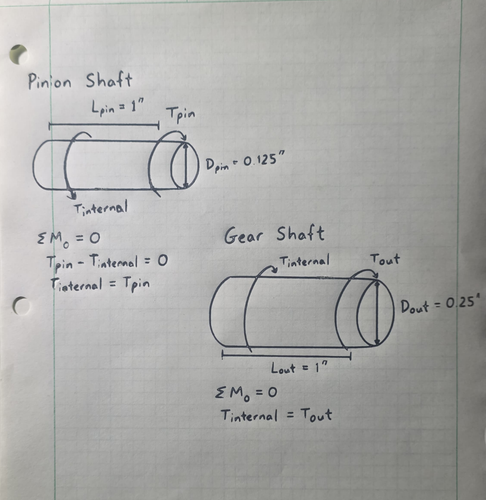
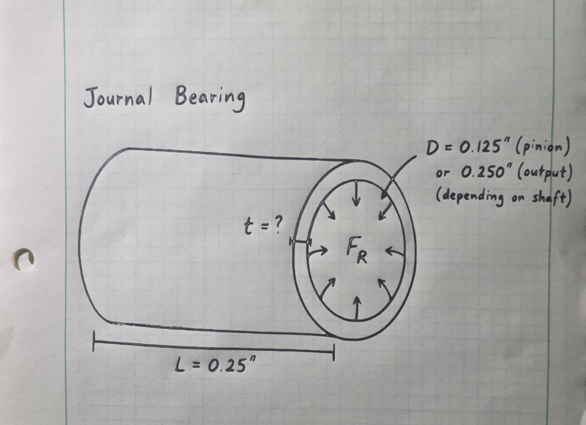
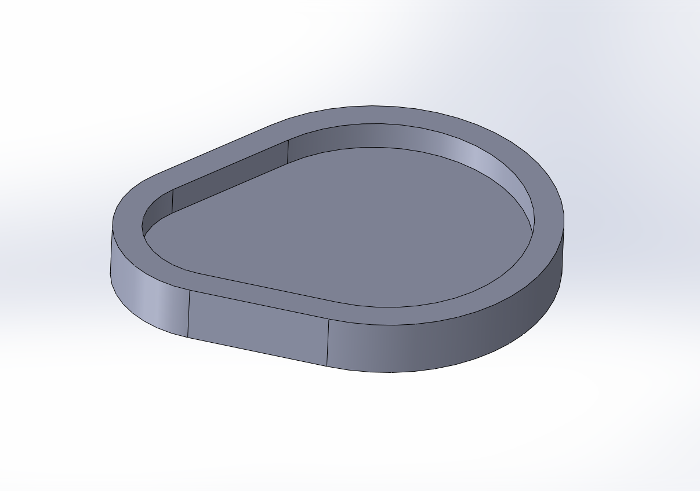
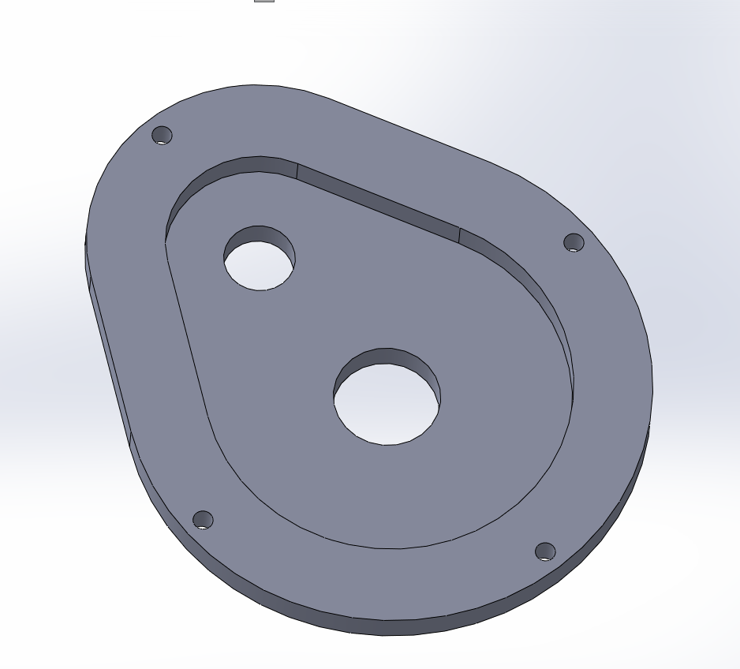
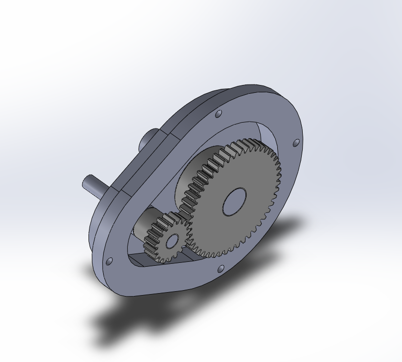
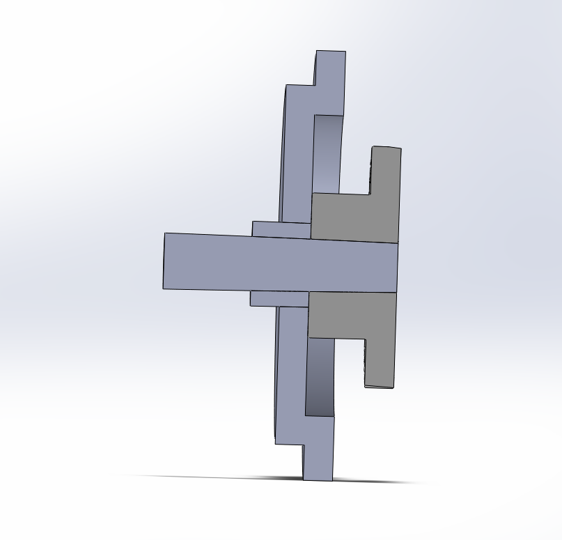
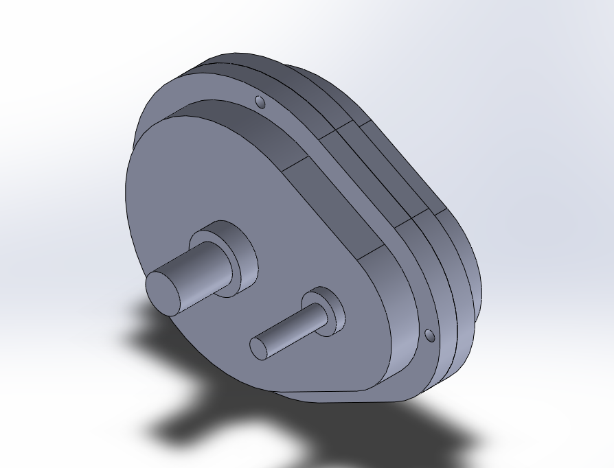
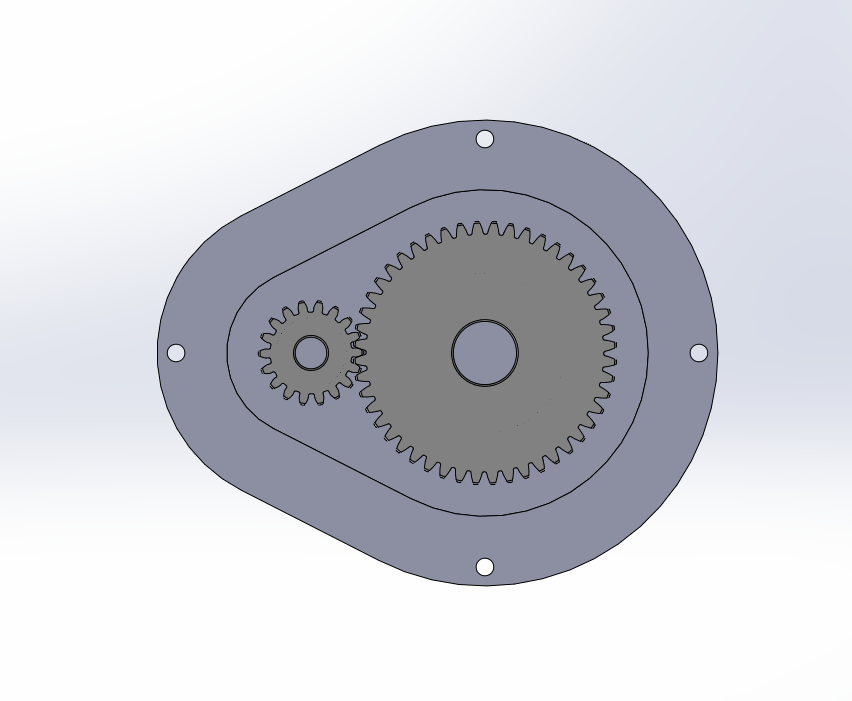

# A8 – Gear Box Design

## Objective

The objective of this assignment was to design a gearbox that could be assembled and disassembled while meeting the required gear ratio, output torque, and output speed. The design also required appropriately sized input and output shafts, journal bearings, a parametric housing, adequate gear clearance, and a fastening method for the two housing halves.

The required gearbox conditions were:

| Requirement | Value |
|---|---:|
| Gear ratio | 24:9 = 2.667:1 |
| Output torque | 1.25 in·lbf |
| Output speed | 1100 rpm |
| Pressure angle | 20° |
| Gear pitch | 48 DP |
| Bearing length | 0.250 in |
| Input shaft length | 1.000 in |
| Output shaft length | 1.000 in |

The final gearbox uses an 18-tooth input pinion and a 48-tooth output gear. Both shafts exit from the same side of the housing.

---

## Analyze

### Gear Selection and Gear Ratio

The gearbox uses two 48-pitch spur gears with a 20° pressure angle.

The selected McMaster-Carr gears were:

| Gear | McMaster Part | Teeth | Pitch Diameter | Bore |
|---|---|---:|---:|---:|
| Input pinion | 7880K19 | 18 | 0.375 in | 0.125 in |
| Output gear | 7880K24 | 48 | 1.000 in | 0.250 in |

The gear ratio is:

$$
i=\frac{N_{out}}{N_{in}}
$$

$$
i=\frac{48}{18}=2.667
$$

This matches the required 24:9 ratio.

The output speed is specified as 1100 rpm, so the required input speed is:

$$
n_{in}=n_{out}i
$$

$$
n_{in}=(1100)(2.667)
$$

$$
\boxed{n_{in}=2933.3\text{ rpm}}
$$

Assuming an ideal gearbox, power is conserved:

$$
T_{in}n_{in}=T_{out}n_{out}
$$

Therefore,

$$
T_{in}=\frac{T_{out}}{i}
$$

$$
T_{in}=\frac{1.25}{2.667}
$$

$$
\boxed{T_{in}=0.46875\text{ in·lbf}}
$$

The output torque remains:

$$
\boxed{T_{out}=1.25\text{ in·lbf}}
$$

The pitch center distance between the gears is:

$$
C=\frac{D_{p,in}+D_{p,out}}{2}
$$

$$
C=\frac{0.375+1.000}{2}
$$

$$
\boxed{C=0.6875\text{ in}}
$$

---

### Shaft Design

I used commercial steel shafting without keyways as the basis for the shaft calculations. From *Machinery's Handbook*, an allowable torsional shear stress of approximately 8,000 psi was used.

The maximum torsional shear stress in a solid circular shaft is:

$$
\tau_{max}=\frac{16T}{\pi d^3}
$$

#### Input Shaft

For the input shaft:

$$
T=0.46875\text{ in·lbf}
$$

$$
d=0.125\text{ in}
$$

$$
\tau_{in}
=
\frac{16(0.46875)}
{\pi(0.125)^3}
$$

$$
\boxed{\tau_{in}=1222\text{ psi}}
$$

The stress ratio relative to the 8,000 psi allowable value is:

$$
\frac{8000}{1222}=6.55
$$

Therefore, the selected 0.125 in input shaft is acceptable for the required torque.

#### Output Shaft

For the output shaft:

$$
T=1.25\text{ in·lbf}
$$

$$
d=0.250\text{ in}
$$

$$
\tau_{out}
=
\frac{16(1.25)}
{\pi(0.250)^3}
$$

$$
\boxed{\tau_{out}=407\text{ psi}}
$$

The corresponding stress ratio is:

$$
\frac{8000}{407}=19.6
$$

The 0.250 in output shaft is therefore also acceptable.

The final shaft dimensions were:

| Shaft | Diameter | Length |
|---|---:|---:|
| Input | 0.125 in | 1.000 in |
| Output | 0.250 in | 1.000 in |

> **Figure 1 – Free-body diagrams used for the input and output shaft analysis**

---

### Gear Forces

The tangential force transmitted between the gears was calculated using the output gear because its torque and pitch radius were known.

The output pitch radius is:

$$
r_{out}=\frac{1.000}{2}=0.500\text{ in}
$$

The tangential gear force is:

$$
F_t=\frac{T}{r}
$$

$$
F_t=\frac{1.25}{0.500}
$$

$$
\boxed{F_t=2.50\text{ lbf}}
$$

For a 20° pressure angle, the radial component is:

$$
F_r=F_t\tan(20^\circ)
$$

$$
F_r=(2.50)\tan(20^\circ)
$$

$$
\boxed{F_r=0.910\text{ lbf}}
$$

This radial force was used for the journal-bearing calculations.

---

### Journal Bearing Design

A bearing length of:

$$
\boxed{L=0.250\text{ in}}
$$

was selected for both journal bearings.

Acetal was selected as the bearing material. The design values used from *Machinery's Handbook* were approximately:

- Maximum pressure: 1000 psi
- Maximum surface velocity: 1000 ft/min
- Maximum PV: 3000 psi·ft/min

#### Input Bearing

The input bearing pressure is:

$$
P=\frac{F_r}{Ld}
$$

$$
P=
\frac{0.910}
{(0.250)(0.125)}
$$

$$
\boxed{P_{in}=29.1\text{ psi}}
$$

Surface velocity is:

$$
V=\frac{\pi dn}{12}
$$

$$
V_{in}
=
\frac{\pi(0.125)(2933.3)}{12}
$$

$$
\boxed{V_{in}=96.0\text{ ft/min}}
$$

The PV value is:

$$
PV=(29.1)(96.0)
$$

$$
\boxed{PV_{in}=2795\text{ psi·ft/min}}
$$

#### Output Bearing

For the output bearing:

$$
P_{out}
=
\frac{0.910}
{(0.250)(0.250)}
$$

$$
\boxed{P_{out}=14.6\text{ psi}}
$$

$$
V_{out}
=
\frac{\pi(0.250)(1100)}{12}
$$

$$
\boxed{V_{out}=72.0\text{ ft/min}}
$$

$$
PV=(14.6)(72.0)
$$

$$
\boxed{PV_{out}=1048\text{ psi·ft/min}}
$$

Both bearings remain below the pressure, velocity, and PV limits used for the selected acetal material. The input bearing produces the larger PV value and therefore controls the bearing check.

The simplified theoretical minimum wall thickness was:

$$
t=
\frac{F_r}
{P_{allow}(2L)}
$$

$$
t=
\frac{0.910}
{(1000)(2)(0.250)}
$$

$$
\boxed{t_{min}=0.00182\text{ in}}
$$

A much larger practical wall thickness was used in CAD.

The final custom bearings were:

| Bearing | ID | OD | Length | Radial Wall Thickness |
|---|---:|---:|---:|---:|
| Input | 0.125 in | 0.250 in | 0.250 in | 0.0625 in |
| Output | 0.250 in | 0.375 in | 0.250 in | 0.0625 in |

> **Figure 2 – Journal-bearing free-body diagram and parametric variables used for the gearbox**

---

### Parametric Housing Design

The housing was modeled parametrically in SolidWorks so that the major dimensions could be controlled from the gear geometry.

Important design variables included:

| Variable | Value |
|---|---:|
| Pinion outside diameter | 0.4167 in |
| Output gear outside diameter | 1.0417 in |
| Gear center distance | 0.6875 in |
| Input shaft diameter | 0.125 in |
| Output shaft diameter | 0.250 in |
| Input bearing OD | 0.250 in |
| Output bearing OD | 0.375 in |
| Bearing length | 0.250 in |
| Gear clearance | 0.125 in |
| Housing wall | 0.125 in |
| Outer flange width | 0.150 in |

The gear outside diameters were calculated from:

$$
D_o=\frac{N+2}{P}
$$

For the 18-tooth pinion:

$$
D_{o,in}=\frac{18+2}{48}
$$

$$
\boxed{D_{o,in}=0.4167\text{ in}}
$$

For the 48-tooth output gear:

$$
D_{o,out}=\frac{48+2}{48}
$$

$$
\boxed{D_{o,out}=1.0417\text{ in}}
$$

A teardrop-shaped housing was then created around these gear envelopes. A 0.125 in gear clearance and 0.125 in housing wall were added around the gear space.

The housing was divided into a base and a removable cover. The base contains both shaft and bearing openings, while the opposite cover remains closed. This creates the selected **Option 2** arrangement in which both the input and output shafts exit from the same side.

> **Figure 3 – Final base housing with bearing openings, internal cavity, flange, and fastener holes**

> **Figure 4 – Closed gearbox cover with matching flange and fastener pattern**

---

### Housing Fastening

A 0.150 in external flange was added around the gearbox housing so the two halves could be clamped together.

Four fasteners were positioned around the flange.

The fastener clearance holes were:

$$
\boxed{\varnothing0.070\text{ in}}
$$

The final fastening system uses:

- Four #0-80 × 3/8 in socket-head machine screws
- Matching narrow-profile #0-80 nuts

The smaller hardware was selected so the fasteners could fit within the narrow outer flange without excessive material overhang.

---

### Design Iteration and Gear Alignment

The first CAD version showed that checking only the gear clearance from the housing walls was not enough. When the McMaster-Carr gears were inserted into the assembly, their hubs introduced an additional axial-clearance requirement.

The section view also showed that the tooth faces of the two gears were not aligned correctly.

> **Figure 5 – Early section view showing the axial clearance problem between the gear hub and housing**

> **Figure 6 – Early gear arrangement showing the axial misalignment between the pinion and output gear**

Instead of modifying the purchased gears, I revised the housing geometry.

The internal cavity depth was increased while the 0.125 in fastening flange thickness was retained. I also added an internal support boss around the input bearing location.

The final boss dimensions were:

$$
OD=0.280\text{ in}
$$

$$
ID=0.250\text{ in}
$$

$$
h=0.060\text{ in}
$$

The 0.060 in boss moved the input pinion into the correct axial position and provided a solid shoulder rather than leaving an unsupported gap between the bearing location and gear hub.

This revision aligned the two gear tooth faces while retaining the original McMaster-Carr gears.

---

## Decide

### Final Gearbox Configuration

I selected the arrangement where **both shafts exit from the same side of the gearbox**.

The final component selections are summarized below.

| Component | Final Selection |
|---|---|
| Input gear | McMaster 7880K19, 18T, 48 DP |
| Output gear | McMaster 7880K24, 48T, 48 DP |
| Gear ratio | 2.667:1 |
| Input shaft | Ø0.125 × 1.000 in |
| Output shaft | Ø0.250 × 1.000 in |
| Input bearing | Ø0.125 ID × Ø0.250 OD × 0.250 in |
| Output bearing | Ø0.250 ID × Ø0.375 OD × 0.250 in |
| Bearing material | Acetal |
| Gear center distance | 0.6875 in |
| Gear clearance | 0.125 in |
| Housing wall | 0.125 in |
| Flange width | 0.150 in |
| Housing fasteners | 4 × #0-80 × 3/8 in |

This arrangement kept the opposite cover simple while allowing both input and output connections to remain accessible from the same side.

---

### Gear Mesh

The final SolidWorks assembly confirmed the required center distance and meshing relationship between the 18-tooth pinion and 48-tooth output gear.

> **Figure 7 – Final 18-tooth and 48-tooth gear mesh inside the housing**

The larger output gear provides the required speed reduction and corresponding torque increase:

$$
2933.3\text{ rpm input}
\rightarrow
1100\text{ rpm output}
$$

and:

$$
0.46875\text{ in·lbf input}
\rightarrow
1.25\text{ in·lbf output}
$$

for the ideal gearbox assumption.

---

## Communicate

### Final Assembly

The completed gearbox consists of:

- Two housing halves
- One 18-tooth input pinion
- One 48-tooth output gear
- One 0.125 in input shaft
- One 0.250 in output shaft
- Two custom journal bearings
- Four housing fasteners and nuts

The housing can be assembled and disassembled using the four perimeter fasteners.

> **Figure 8 – Final assembled gearbox with both shafts and housing fasteners installed**

---

### Engineering Lessons Learned

This assignment showed me that designing around gears requires more than checking their outside diameters. My first housing had enough clearance around the gear teeth when viewed from the front, but the section view revealed that the gear hubs and tooth faces created additional axial requirements.

I also learned that imported hardware should be checked in the assembly before the housing geometry is considered final. The actual McMaster-Carr gear models exposed dimensional details that were not obvious when I was initially creating the housing envelope.

The pinion and output gear also had different hub geometries, which caused the tooth faces to be axially misaligned. Instead of changing the purchased gears, I revised the housing and added a 0.060 in support boss at the input bearing location. This corrected the alignment while also providing physical support behind the pinion.

Using parametric variables for the gear diameters, center distance, clearances, bearing sizes, and housing dimensions made these design changes much easier because the major dimensions were already related to the selected components.

The section-view tool was especially useful because several of the problems could not be seen clearly from a normal isometric view.

Overall, the final design met the required gear ratio, provided adequate shaft and bearing capacity, allowed the housing to be assembled and disassembled, and packaged the gears into a compact housing with both shafts accessible from the same side.

---

### Time Spent

Approximately **10 hours** were spent completing the calculations, CAD modeling, design revisions, assembly, and documentation for this assignment.

---

## CAD Download

The complete SolidWorks gearbox files are provided as one ZIP archive:

[Download A8 Gearbox CAD Files](../../assets/files/A8_Gearbox_CAD_Files.zip)

---

## References

1. MEGR 2156 Assignment 8 – Gear Box Design instructions.
2. *Machinery's Handbook*, 31st Edition, Industrial Press.
3. McMaster-Carr 7880K19 – 18-tooth, 48-pitch spur gear.
4. McMaster-Carr 7880K24 – 48-tooth, 48-pitch spur gear.
