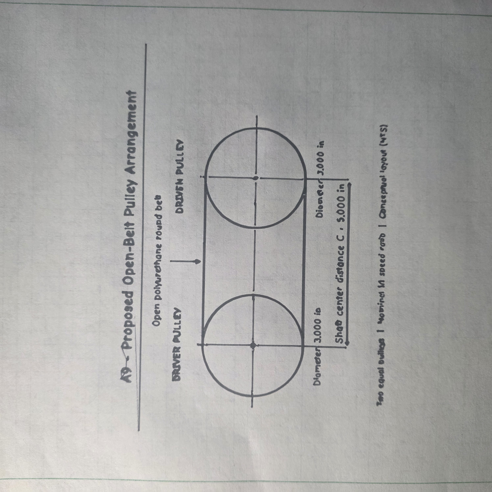
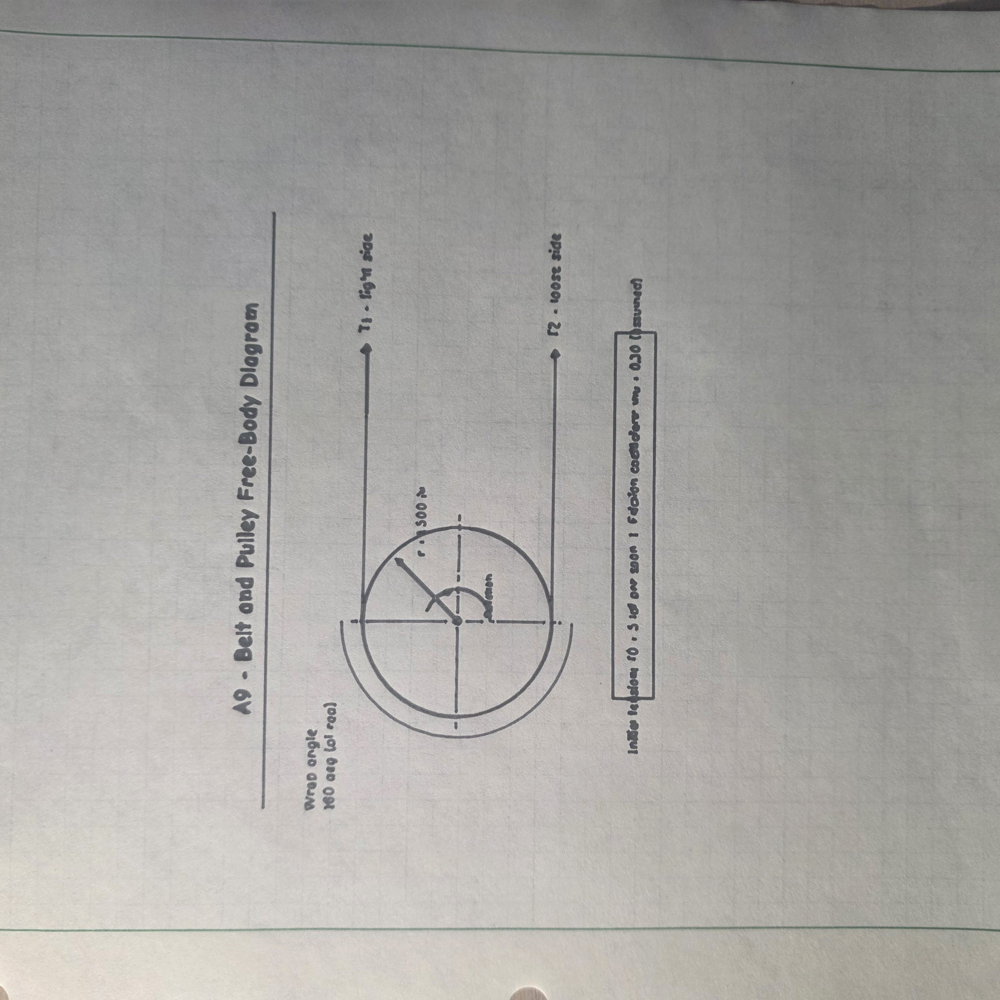
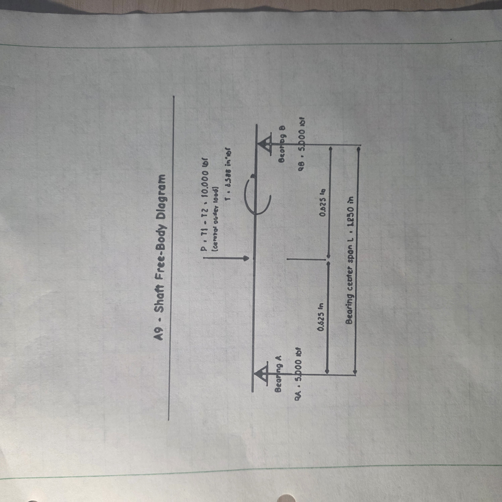
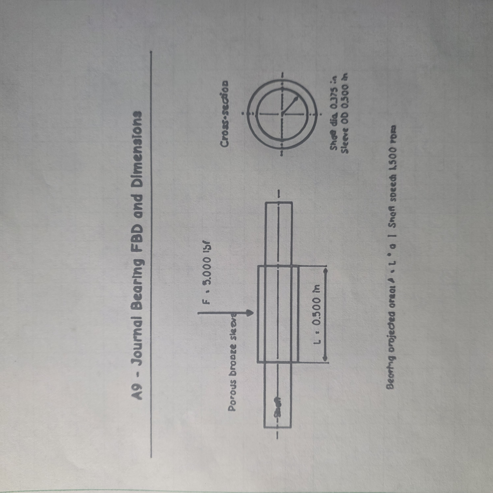
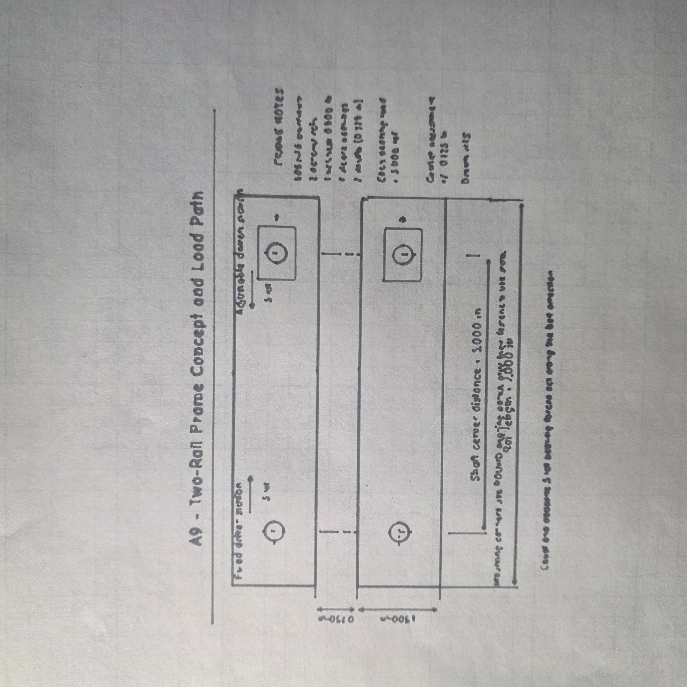
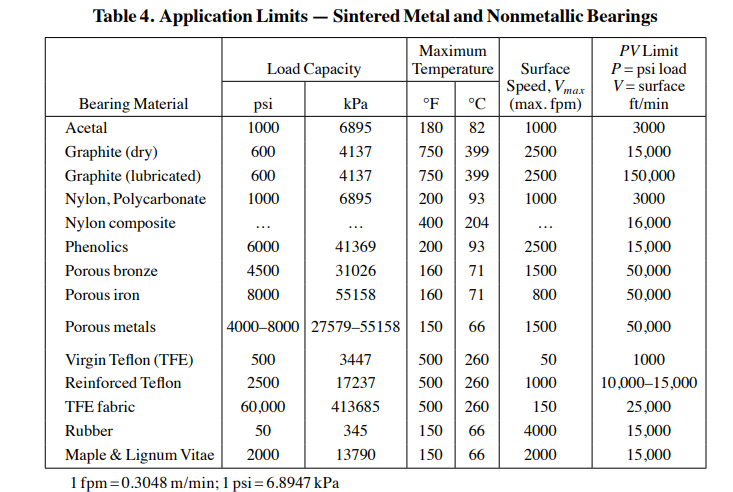
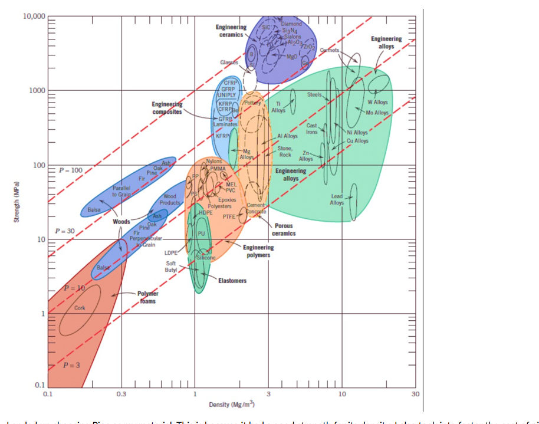

# A9 – Pulley System Design

## Objective

The objective of this assignment is to design a pulley system that transfers power between two parallel shafts. The system must use two 3-inch pulleys separated by a center distance of 4–6 inches. The design requires analysis of belt friction and tension, minimum shaft diameter, journal-bearing performance, and a frame capable of supporting the pulley system.

The required design conditions are:

| Requirement | Value |
|---|---:|
| Pulley diameter | 3.000 in each |
| Shaft center distance | 4–6 in |
| Operating speed | 1,000–2,000 rpm |
| Static belt tension | 4–6 lbf |
| Pulley material | Aluminum, ABS, or steel |
| Belt material | Polyurethane rubber |
| Belt yield strength at 20% strain | 3.25 MPa (471 psi) |
| Shaft material | 1060 hardened steel |
| Minimum safety factor | 3 |

I approached the system as a connected set of design problems: the belt forces determine the torque and radial loading on the shafts; those loads then determine the shaft, journal-bearing, and frame requirements.

> **Working design:** This page is being developed as the calculations and component selections are verified. Values identified as preliminary are design assumptions, not measured results or completed tests.

---

## Analyze

### Selected Operating Conditions

I started with the following operating conditions, all within the limits given in the assignment:

| Parameter | Symbol | Preliminary Value |
|---|---|---:|
| Pulley diameter | $D$ | 3.000 in |
| Pulley radius | $r$ | 1.500 in |
| Center distance | $C$ | 5.000 in |
| Rotational speed | $n$ | 1,500 rpm |
| Static tension in each belt span | $T_0$ | 5.000 lbf |
| Belt wrap angle | $\theta$ | $180^\circ=\pi$ rad |
| Assumed belt-to-pulley friction coefficient | $\mu$ | 0.30 |
| Required safety factor | $N$ | 3 |

The two pulleys have equal diameters, so an ideal open-belt drive has a 1:1 speed ratio. The belt wraps approximately 180° around each pulley.

The coefficient of friction is a **working assumption**. It must be checked against the materials and operating conditions before the belt design is treated as final.

> **Figure 1 – Pulley-system layout showing the two 3-inch pulleys and 5-inch center distance** *(image pending)*

---

### Belt Design

#### Knowns and Unknowns

**Knowns:** $D=3$ in, $r=1.5$ in, $T_0=5$ lbf per span, $\theta=\pi$ rad, $S_y=471$ psi, and $N=3$.

**Assumption for analysis:** $\mu=0.30$.

**Unknowns:** Tight-side tension $T_1$, loose-side tension $T_2$, minimum belt cross-sectional area $A_{\min}$, minimum round-belt diameter $d_{\min}$, and a suitable belt circumference.

> **Figure 2 – Belt and pulley free-body diagram showing tight-side tension, loose-side tension, and the wrap angle** *(image pending)*

#### Tight-Side and Loose-Side Belt Forces

For a belt initially tensioned equally on both spans, the simplified relationship between the running tensions and the initial pretension is:

$$
T_1+T_2=2T_0
$$

At the threshold of slipping, the capstan equation is:

$$
\frac{T_1}{T_2}=e^{\mu\theta}
$$

Substituting the capstan relationship into the tension equation gives:

$$
T_1=\frac{2T_0e^{\mu\theta}}{1+e^{\mu\theta}}
$$

$$
T_2=\frac{2T_0}{1+e^{\mu\theta}}
$$

With $\mu=0.30$ and $\theta=\pi$:

$$
e^{\mu\theta}=e^{(0.30)(\pi)}=2.5663
$$

Therefore, the limiting belt forces immediately before slip are:

$$
T_1=\frac{2(5)(2.5663)}{1+2.5663}
$$

$$
\boxed{T_1=7.196\text{ lbf}}
$$

and:

$$
T_2=\frac{2(5)}{1+2.5663}
$$

$$
\boxed{T_2=2.804\text{ lbf}}
$$

These are **limiting forces for the assumed friction coefficient**, not measured operating forces. The sum remains 10 lbf under the simplified constant-pretension model.

#### Minimum Belt Cross-Section

The allowable tensile stress, using the required safety factor, is:

$$
\sigma_{\mathrm{allow}}=\frac{S_y}{N}
$$

$$
\sigma_{\mathrm{allow}}=\frac{471}{3}=157\text{ psi}
$$

The maximum belt tension controls the required cross-sectional area:

$$
\sigma=\frac{T_1}{A}\leq\sigma_{\mathrm{allow}}
$$

Rearranging:

$$
A_{\min}=\frac{NT_1}{S_y}
$$

$$
A_{\min}=\frac{3(7.196)}{471}
$$

$$
\boxed{A_{\min}=0.04583\text{ in}^2}
$$

For a round belt:

$$
A=\frac{\pi d^2}{4}
$$

Solving for diameter:

$$
d_{\min}=\sqrt{\frac{4A_{\min}}{\pi}}
$$

$$
d_{\min}=\sqrt{\frac{4(0.04583)}{\pi}}
$$

$$
\boxed{d_{\min}=0.2416\text{ in}}
$$

A **5/16-inch (0.3125-inch) round polyurethane belt** is a preliminary candidate because its diameter is above the calculated minimum.

Its cross-sectional area is:

$$
A_{5/16}=\frac{\pi(0.3125)^2}{4}=0.07670\text{ in}^2
$$

The theoretical tensile-yield safety factor at the limiting belt force is:

$$
N_{\mathrm{belt}}=\frac{S_yA_{5/16}}{T_1}
$$

$$
N_{\mathrm{belt}}=\frac{471(0.07670)}{7.196}
$$

$$
\boxed{N_{\mathrm{belt}}\approx5.02}
$$

This exceeds the required safety factor of 3 **for this specific tensile-strength model**. It does not verify belt splice strength, creep, fatigue life, or actual grip at speed.

> **Figure 3 – Round-belt cross-section and minimum-diameter calculations** *(image pending)*

#### Belt Circumference and Selection

For two equal pulleys, the belt path length at the **pulley surface** is:

$$
L_{\mathrm{surface}}=2C+\pi D
$$

$$
L_{\mathrm{surface}}=2(5)+\pi(3)
$$

$$
\boxed{L_{\mathrm{surface}}=19.425\text{ in}}
$$

For an ideal ungrooved pulley with a 5/16-inch round belt, the belt-centerline path would be approximately:

$$
L_{\mathrm{centerline}}=2C+\pi(D+d)
$$

$$
L_{\mathrm{centerline}}=2(5)+\pi(3+0.3125)
$$

$$
\boxed{L_{\mathrm{centerline}}=20.407\text{ in}}
$$

The corresponding geometric **outer-edge path** is approximately:

$$
L_{\mathrm{outer}}=2C+\pi(D+2d)
$$

$$
\boxed{L_{\mathrm{outer}}=21.388\text{ in}}
$$

These lengths are geometric estimates, **not a confirmed catalog belt size**. Groove depth, actual belt position, and required stretch to produce the specified 5-lbf pretension must be considered before choosing a commercial belt by its advertised outside circumference.

> **Figure 4 – Selected polyurethane round belt and manufacturer specifications** *(image pending)*

---

### Shaft Diameter Design

The shaft is specified as **1060 hardened steel**. The minimum shaft diameter must resist the torque transmitted through the pulley while meeting a safety factor of at least 3. The pulley also applies a radial load to the shaft, so bending should be considered when determining the practical shaft size.

#### Knowns and Unknowns

**Knowns:** $r=1.5$ in, $T_1=7.196$ lbf, $T_2=2.804$ lbf, and $N=3$.

**Unknowns:** Shaft torque $M_t$, torsional stress $\tau$, shaft diameter $d_s$, and the effect of bending.

> **Figure 5 – Shaft free-body diagram showing belt forces, torque, and bearing reactions** *(image pending)*

#### Applied Shaft Torque

The maximum torque that can be transmitted at the assumed no-slip limit is:

$$
M_t=r(T_1-T_2)
$$

$$
M_t=1.5(7.196-2.804)
$$

$$
\boxed{M_t=6.588\text{ lbf}\cdot\text{in}}
$$

This is the **friction-limited theoretical torque** for the stated conditions, not an assigned motor torque.

#### Minimum Diameter Under Torsion

For a solid circular shaft:

$$
\tau_{\max}=\frac{16M_t}{\pi d_s^3}
$$

Using the von Mises yield criterion for pure torsion:

$$
\sqrt{3}\,\tau_{\max}\leq\frac{S_{y,\mathrm{steel}}}{N}
$$

Solving symbolically for the minimum shaft diameter:

$$
\boxed{d_{s,\min}=\left(\frac{16\sqrt{3}\,M_tN}{\pi S_{y,\mathrm{steel}}}\right)^{1/3}}
$$

For a **provisional material-property example** using $S_{y,\mathrm{steel}}=70{,}000$ psi:

$$
d_{s,\min}=\left(\frac{16\sqrt{3}(6.588)(3)}{\pi(70{,}000)}\right)^{1/3}
$$

$$
\boxed{d_{s,\min}\approx0.1356\text{ in (torsion only)}}
$$

**Material verification needed:** The 70,000-psi yield-strength value is a working assumption, not a verified specification for the particular hardening condition of the 1060 steel we would use.

#### Including Shaft Bending

The approximate resultant belt load on a pulley is:

$$
F=T_1+T_2=10.0\text{ lbf}
$$

If the pulley is centered between two supports separated by a **proposed** 1.50-inch bearing span, the maximum bending moment is:

$$
M_b=\frac{FL_s}{4}
$$

$$
M_b=\frac{10(1.50)}{4}=3.75\text{ lbf}\cdot\text{in}
$$

For combined bending and torsion:

$$
\sigma_{\mathrm{VM}}=\sqrt{\left(\frac{32M_b}{\pi d_s^3}\right)^2+3\left(\frac{16M_t}{\pi d_s^3}\right)^2}
$$

Setting $\sigma_{\mathrm{VM}}\le S_{y,\mathrm{steel}}/N$ and solving for $d_s$:

$$
d_{s,\min}=\left[\frac{N\sqrt{(32M_b)^2+3(16M_t)^2}}{\pi S_{y,\mathrm{steel}}}\right]^{1/3}
$$

For the provisional values:

$$
\boxed{d_{s,\min}\approx0.1439\text{ in (combined loading)}}
$$

A **3/8-inch nominal steel shaft** is the proposed practical size. This allows a standard bearing bore and provides additional stiffness, but final selection depends on a verified steel grade/condition and the actual support arrangement.

> **Figure 6 – Shaft diameter derivation and numerical strength check** *(image pending)*

---

### Journal Bearing Design

The journal bearings support the rotating shafts and must withstand radial pressure and sliding motion without exceeding the material's pressure, velocity, or PV limits.

#### Knowns and Unknowns

For the preliminary bearing arrangement:

| Parameter | Symbol | Value |
|---|---|---:|
| Shaft diameter | $d_s$ | 0.375 in |
| Shaft speed | $n$ | 1,500 rpm |
| Total radial belt load per pulley | $F$ | 10.0 lbf |
| Number of bearings per shaft | — | 2 |
| Bearing length | $L_b$ | 0.500 in |

**Unknowns:** Load on each bearing $F_b$, projected bearing pressure $P$, shaft surface velocity $V$, PV value, and a suitable bearing material.

> **Figure 7 – Journal-bearing free-body diagram and bearing dimensions** *(image pending)*

#### Bearing Load and Pressure

If two equally spaced bearings support a centered pulley load, each bearing carries:

$$
F_b=\frac{F}{2}=\frac{10}{2}=5.0\text{ lbf}
$$

For a journal bearing, the projected contact area is:

$$
A_p=d_sL_b
$$

The pressure is:

$$
P=\frac{F_b}{d_sL_b}
$$

$$
P=\frac{5}{(0.375)(0.500)}
$$

$$
\boxed{P=26.67\text{ psi}}
$$

#### Surface Velocity

For a shaft diameter in inches and speed in rpm, the surface velocity in ft/min is:

$$
V=\frac{\pi d_sn}{12}
$$

$$
V=\frac{\pi(0.375)(1500)}{12}
$$

$$
\boxed{V=147.26\text{ ft/min}}
$$

#### Pressure–Velocity Rating

$$
PV=P\times V
$$

$$
PV=(26.67)(147.26)
$$

$$
\boxed{PV\approx3{,}927\text{ psi}\cdot\text{ft/min}}
$$

The intended material check uses **Table 4, page 2440 of *Machinery's Handbook***. Porous bronze is a preliminary candidate because the assigned reference table lists a PV limit of approximately 50,000 psi·ft/min. Final selection should also check the table's pressure and speed limits and confirm the particular commercial bearing material.

> **Figure 8 – *Machinery's Handbook* bearing material table with the selected material identified** *(image pending)*

A **3/8-inch ID × 1/2-inch OD × 1/2-inch long sleeve bearing** is the preliminary dimensional choice. A specific product and its material grade still need confirmation.

> **Figure 9 – Selected journal bearing and actual supplier dimensions** *(image pending)*

---

### Frame Design

The frame must maintain the 5-inch distance between the shaft centers and transmit the shaft/bearing reactions to the supports. I am evaluating a frame made from **6061-T6 aluminum**, with two support plates and journal bearings to locate the shafts.

One possible arrangement uses two parallel plates, each supporting one bearing at each pulley station. The belt force on each pulley is approximately 10 lbf, so each of the two supports would carry approximately 5 lbf if the shaft loading is symmetric.

The engineering checks for the selected frame should include the net section around the holes, bearing-hole contact, bending or compression as appropriate, and the required safety factor of at least 3.

> **Figure 10 – Dimensioned frame concept showing the two shaft locations** *(image pending)*

> **Figure 11 – Frame free-body diagram and strength calculation** *(image pending)*

The frame geometry and its numerical safety factor will be added after we agree on the actual plate dimensions, hole locations, and mounting arrangement. I am not claiming that this portion has been verified yet.

---

## Decide

### Preliminary Component Selections

Based on the analysis so far, the proposed configuration is:

| Component | Working Selection | Reason |
|---|---|---|
| Pulley arrangement | Two equal 3.000-in pulleys | Meets required geometry and gives a 1:1 ratio |
| Center distance | 5.000 in | Midpoint of required range |
| Operating speed | 1,500 rpm | Midpoint of specified range |
| Static belt tension | 5 lbf per span | Midpoint of specified range, explicitly interpreted per span |
| Pulley material | 6061-T6 aluminum | Practical, lightweight candidate |
| Belt | 5/16-in round polyurethane | Above the preliminary minimum diameter |
| Shaft | 3/8-in nominal 1060 hardened steel | Practical stock diameter for journal bearings |
| Journal bearing | Porous bronze candidate; 3/8-in ID × 1/2-in OD × 1/2-in long | Preliminary pressure/velocity/PV compatibility |
| Frame | Two aluminum support plates | Supports both parallel shafts; final dimensions pending |

These choices are **not yet final purchase specifications**. In particular, the belt's actual circumference and installed pretension, the steel's documented yield strength, the commercial bearing material, and the frame layout remain to be finalized.

The objective is to keep the entire design consistent: the same pulley dimensions, belt forces, transmitted torque, shaft loads, and bearing reactions must be used across each section.

---

## Communicate

### Design Documentation

The completed assignment will include the pulley and belt layout, belt-force FBD, minimum belt section analysis, shaft FBD and diameter calculation, journal-bearing FBD and PV calculation, bearing material reference, and a dimensioned frame sketch with supporting analysis.

The corresponding figure positions have been reserved throughout this page, starting at **95.png**, immediately after the final A8 image (**94.png**). Each figure will be added when the actual sketch, calculation, or product reference is ready.

### Engineering Lessons Learned

*To be completed from the actual design process. This section will explain specific technical lessons—for example, how the friction assumption affects tension distribution, how belt loads act on the shaft even when torque is modest, and why pressure and PV must both be checked for a journal bearing. Only lessons actually encountered during the work will be presented as personal observations.*

### Time Spent

*Actual time spent will be added after completion.*

---

## References

1. MEGR 2156, *Pulley System* assignment instructions and rubric (portfolio assignment A9).
2. D. J. Dunn, *Solid Mechanics – Dynamics: Tutorial – Pulley Drive Systems* (assigned reading).
3. *Simple Stresses*, p. 217, Table 2 (assigned reference).
4. *Machinery's Handbook*, p. 2440, Table 4, application limits for sintered-metal and nonmetallic bearings.
5. [McMaster-Carr – Round Belts](https://www.mcmaster.com/products/round-belts/round-belts-8/) (assigned selection resource; specific product pending).
