# A10 – Lead Screw Translating System

## Objective

* This assignment was a group assignment that consisted of coordinating with teammates in
order to design a project with set constraints. A tensile tester is a mechanism that through
uniaxial tension allows engineers to test materials and gather information about it's properties
such as yield strength, ultimate yield strength and elongation at break. This information can be
used for deciding material usage in different applications. The objective of this assignment was
to design a tensile tester that could handle a 2kN axial load and a crosshead speed from 1-50
mm/min. As a team we developed a lead screw, and ensure that our tensile tester would be
accurate and could repeatedly apply a 2 kN load.

## Analyze

### Diameter- Farima Pournia

* For deciding on what lead screw to select the diameter was first calculated. This was done by
using the guidelines given like yield strength, force, and safety factor. The safety factor equation
was used to be set equal to the stress equation which used the area of a circle for it's area
equation. The parameters were then plugged into this equation and the diameter was solved for.

> **Figure 1 – Lead screw diameter calculations – Farima Pournia**

* To select a diameter for the lead screw the closest diameter to the one calculated is 5.97 mm
which corelates with a 3/8-10 screw.

### Rotational Speed- Farima Pournia

* The rotational speed of the lead screw was then calculated through the speed range given and
the screw lead that was found through the diameter that was calculated. Using the equation for
linear speed rotational speed was solved for. This equation was then used to plug in the lower
and upper bounds of the linear speed range and a range for rotational speed was calculated.

> **Figure 2 – Rotational speed calculations – Farima Pournia**

### Torque- Farima Pournia

* The next parameter that was calculated was torque by using the equation for a square
threaded lead screw. The diameter of the actual screw selected was used and not the diameter
that was calculated. The screw lead was found through the diameter of the screw selected and
the coefficient of friction was found in the Machinery Handbook under the value for friction of
steel against bronze. These values were plugged into the torque equation and solved.

> **Figure 3 – Torque calculations – Farima Pournia**

* From calculating these parameters a lead screw was chosen from McMaster Carr. The closest
diameter of lead screw that fit the diameter that was solved for was 5.97 mm, so a 3/8-10 steel
acme lead screw was selected. For this assignment our lead screw is required to be at least 18
inches. The lead screw sizing selected only had 3 feet, 6 feet or 12 inches. So to accommodate
for this we selected the 3 foot long lead screw and would cut it down closer to size. The lead
screw we selected is linked below.

https://www.mcmaster.com/93410A608/

### Nut and Flange Design – A.C. Florencondia

The nut and flange assembly transfers the axial load from the two lead screws to the crosshead. Under the assumed symmetric loading condition, each assembly supports 1,000 N of the total 2,000 N tensile load. A minimum factor of safety of 4 was used for the internal thread stress analysis.

I selected the 673 bronze externally threaded nut (McMaster-Carr 95072A127) and a separate 1215 carbon steel mounting flange (95082A641) to match the nominal 3/8-10 right-hand, single-start Stub Acme geometry of the selected lead screw. The nut has a 9/16-18 external mounting thread, which mates with the flange. A compatible one-piece bronze flanged nut was not found in the catalog during the selection process.

#### Internal Thread Stress Analysis

The calculation sheet includes the knowns and unknowns, the free-body diagram, symbolic equations, and numerical solutions. Each assembly is modeled with a 1,000 N axial load and two equivalent 500 N forces acting on the flange. These are idealized resultant forces, not individual bolt loads.

> **Figure 4 – Nut and flange calculations and free-body diagram**

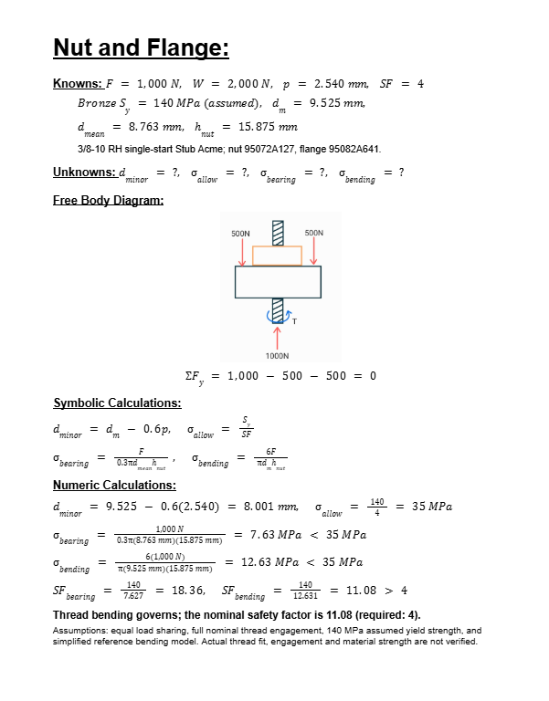

| Parameter | Calculated or selected value |
|---|---:|
| Total tensile load | 2,000 N |
| Axial load per nut | 1,000 N |
| Thread pitch | 2.540 mm |
| Nominal nut length | 15.875 mm |
| Assumed bronze yield strength | 140 MPa |
| Required safety factor | 4 |
| Allowable stress | 35.00 MPa |
| Nominal thread bearing stress | 7.63 MPa |
| Nominal thread bending stress | 12.63 MPa |
| Nominal bearing safety factor | 18.36 |
| Nominal bending safety factor | 11.08 |

Thread bending governs the simplified internal-thread check. The nominal factor of safety of 11.08 exceeds the required value of 4 under the assumptions of equal load sharing, uniform loading over the full nominal engagement length, and an assumed bronze yield strength of 140 MPa. This is a preliminary calculation, not a certified load rating. Actual material strength, effective thread engagement, thread fit between the selected screw and nut, and the mounting connection must be verified before fabrication.

#### Selected Nut and Flange

> **Figure 5 – McMaster-Carr dimensioned drawing of the selected bronze nut (95072A127)**

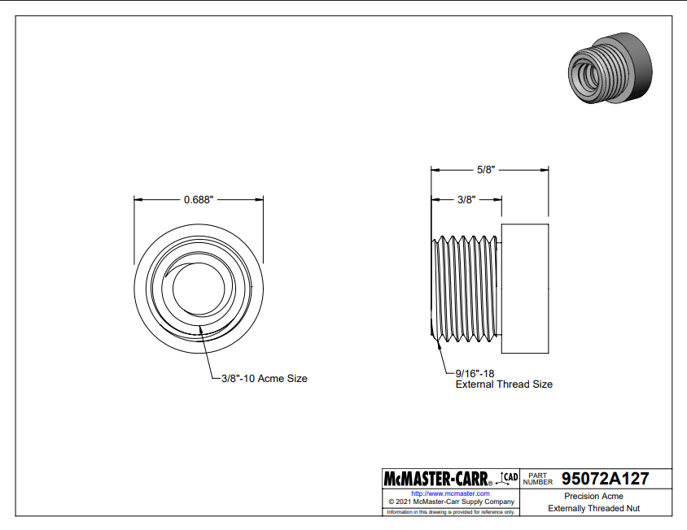

> **Figure 6 – McMaster-Carr dimensioned drawing of the selected steel flange (95082A641)**

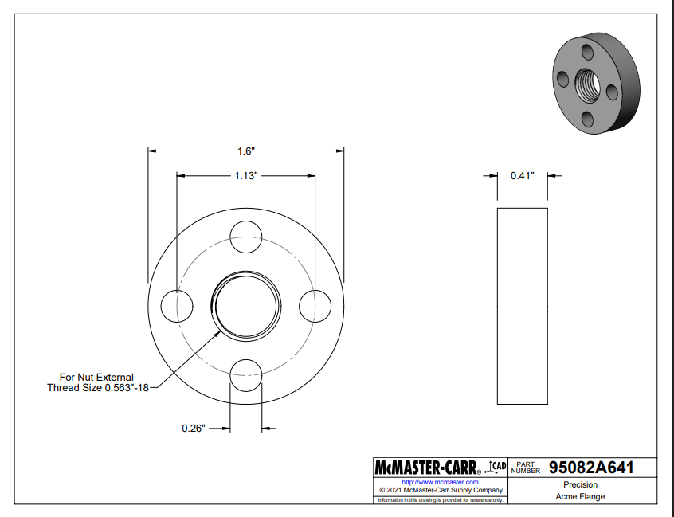

| Component | Part number | Quantity | Key dimensions |
|---|---|---:|---|
| Bronze nut | [95072A127](https://www.mcmaster.com/95072A127/) | 2 | 3/8-10 internal thread; 0.688 in OD; 0.625 in length |
| Steel flange | [95082A641](https://www.mcmaster.com/95082A641/) | 2 | 9/16-18 mounting thread; nominal 1.609 in OD; 1.125 in bolt circle |

The two-piece configuration was selected because it provides a mounting flange without changing the lead screw selected by the team. The steel flange provides the mounting interface to the crosshead, while the bronze nut provides the internal threads that engage the lead screw.

---

### Crosshead Design and CAD - Rebekah Smith

The objective of this portion of the project was to design a crosshead for a mechanically driven tensile testing machine capable of applying a maximum tensile load of 2 kN. The crosshead connects the two vertical leadscrews through bronze nut and flange assemblies and provides a mounting location for the tensile specimen. The design required selecting an appropriate material and cross-sectional dimensions while maintaining a factor of safety of 4 and limiting the maximum crosshead deflection to 0.1 mm. Beam strength and deflection analyses were performed to determine whether the proposed crosshead dimensions would meet the design requirements.

### Crosshead Design – Beam Strength Analysis

The crosshead was modeled as a simply supported beam with a concentrated load applied at its center. The two bronze nut and flange assemblies act as the supports for the crosshead. The two support reactions represent the forces from the left and right bronze nut and flange assemblies. Because the loading is symmetrical, both support reactions are equal.

> **Figure 7 – Crosshead beam strength analysis and free-body diagram – Rebekah Smith**

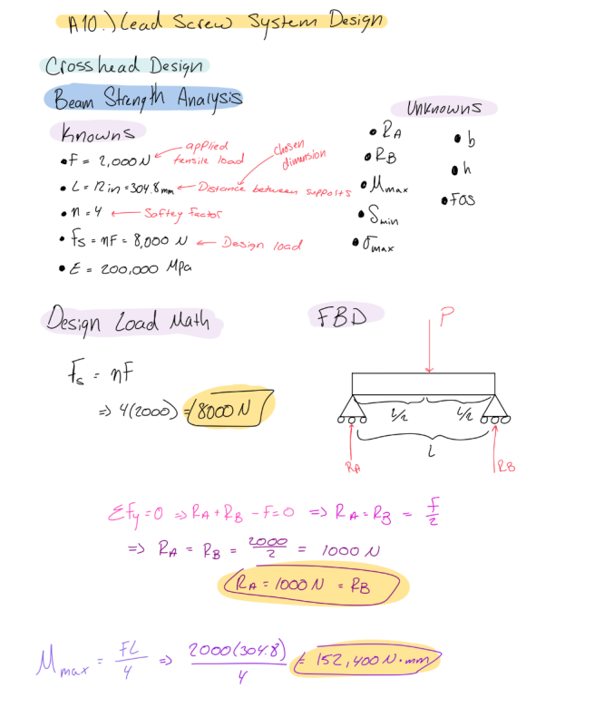

> **Figure 8 – Symbolic and numerical beam strength calculations – Rebekah Smith**

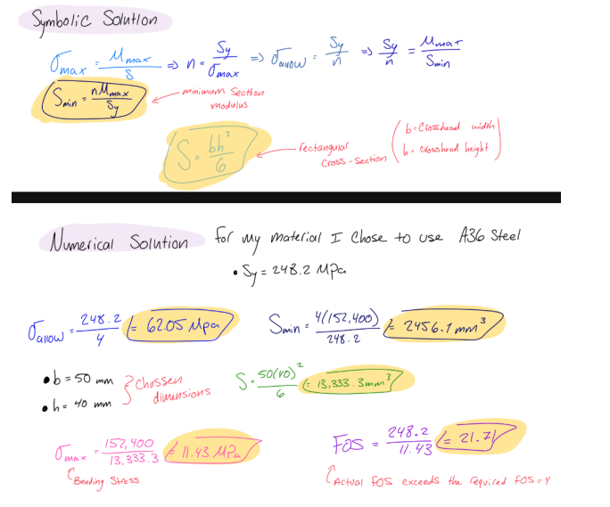

Using static equilibrium, the support reactions can be determined by summing the vertical forces. Sum of forces in the vertical direction: ΣFy = 0, RA + RB - F = 0 Due to symmetrical loading: RA = RB Therefore: RA = RB = F/2 The maximum bending moment for a simply supported beam with a centered point load is: Mmax = FL/4 The bending stress equation is: σmax = Mmax/S The allowable stress using a safety factor of 4 is: σallow = Sy/n Rearranging the bending stress equation to determine the minimum required section modulus: Smin = nMmax/Sy For a rectangular cross-section, the section modulus is: S = bh²/6.

First, calculate the support reactions: RA = RB = 2000/2, RA = RB = 1,000 N Calculate the maximum bending moment: Mmax = (2000)(304.8)/4 Mmax = 152,400 N·mm Calculate the allowable bending stress: σallow = 248.2/4 σallow = 62.05 MPa Calculate the minimum required section modulus: Smin = (4)(152400)/248.2 Smin = 2,456.1 mm³ A rectangular cross-section measuring 50 mm wide and 40 mm high was selected. Calculate the section modulus: S = (50)(40²)/6 S = 13,333.3 mm³ Calculate the maximum bending stress: σmax = 152400/13333.3 σmax = 11.43 MPa Calculate the actual factor of safety: FOS = 248.2/11.43 FOS = 21.71 The calculated factor of safety of 21.71 exceeds the required factor of safety of 4. Therefore, the selected A36 steel cross-section satisfies the preliminary beam strength requirement.

#### Crosshead Design – Beam Deflection Analysis

The deflection analysis was performed to determine whether the selected crosshead dimensions could maintain a maximum deflection of 0.1 mm under the applied 2 kN tensile load. The same simply supported beam configuration and centered load were used for the deflection analysis. The maximum deflection occurs at the center of the beam, where the tensile load is applied.

> **Figure 9 – Crosshead beam deflection calculations – Rebekah Smith**

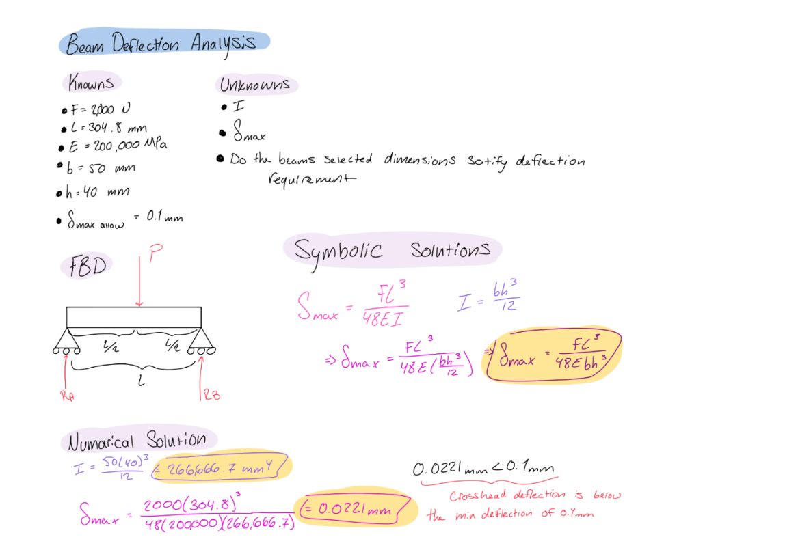

For a simply supported beam with a concentrated load at the center, the maximum deflection is: δmax = FL³/(48EI) The area moment of inertia for a rectangular cross-section is: I = bh³/12Substituting the moment of inertia equation into the deflection equation: δmax = FL³/[48E(bh³/12)] Simplifying: δmax = FL³/(4Ebh³) First, calculate the area moment of inertia: I = (50)(40³)/12 I = 266,666.7 mm⁴ Calculate the maximum deflection: δmax = [(2000)(304.8³)]/[(48)(200000)(266666.7)] δmax = 0.0221 mm Compare the calculated deflection to the maximum allowable deflection: 0.0221 mm < 0.1 mm The calculated maximum deflection of 0.0221 mm is below the allowable deflection of 0.1 mm. Therefore, the selected crosshead dimensions satisfy the preliminary stiffness requirement.

#### Crosshead Material and Dimension Selection

A36 structural steel was selected for the crosshead because of its strength, stiffness, availability, and ease of manufacturing. A rectangular cross-section was selected with a width of 50 mm and a height of 40 mm. The strength analysis resulted in a maximum bending stress of 11.43 MPa and an actual factor of safety of 21.71, exceeding the required factor of safety of 4. The deflection analysis resulted in a maximum deflection of 0.0221 mm, which is below the allowable deflection of 0.1 mm. Based on these calculations, the selected 50 mm × 40 mm A36 steel cross-section satisfies the preliminary beam strength and deflection requirements.

> **Figure 10 – Crosshead SolidWorks model – Rebekah Smith**

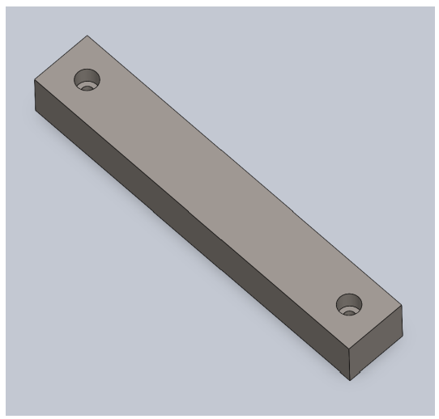

> **Figure 11 – Crosshead A36 steel material properties – Rebekah Smith**

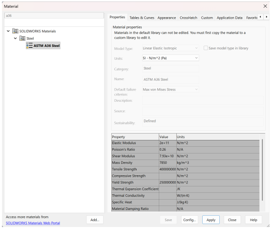

> **Figure 12 – Crosshead parametric equations and global variables – Rebekah Smith**

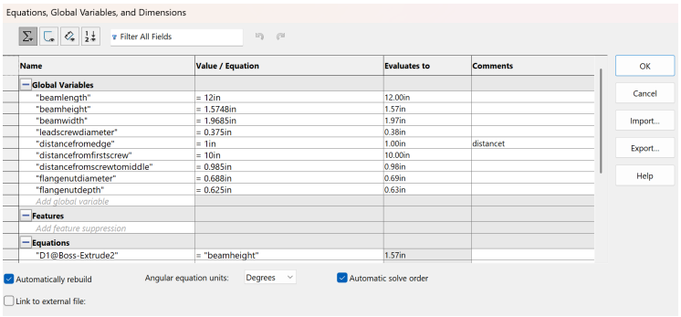

A multiview engineering sketch was created to communicate the overall geometry, dimensions, and mounting features of the tensile tester crosshead. The drawing includes top, front, and side views to show the crosshead dimensions and the locations of the two leadscrew mounting points. The crosshead was designed using A36 structural steel. The overall length is 12 inches, with 10 inches between the centers of the two leadscrew mounting holes. Each mounting location includes a 0.375-inch center hole and a 0.688-inch counterbore to accommodate the nut and flange assembly. The counterbore depth is 0.625 inches. The crosshead has a width of 1.968 inches and a height of 1.574 inches. These dimensions provide the required space for the mounting features while maintaining the rectangular cross-section used in the beam strength and deflection analyses.

 > **Figure 13 – Crosshead multiview engineering sketch – Rebekah Smith**

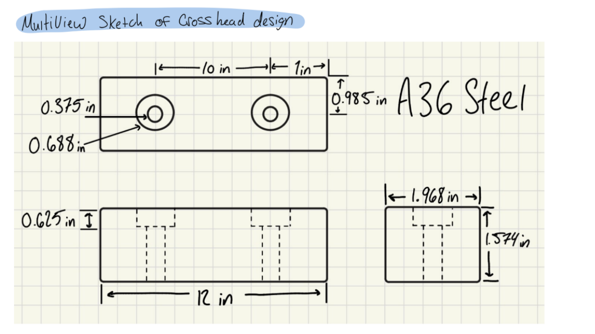

#### Lessons Learned – Rebekah Smith

During the crosshead design process, I learned how to apply beam bending stress and deflection equations to determine the dimensions required for a mechanical structure. I learned that material selection requires considering both yield strength and elastic modulus because strength and stiffness affect different parts of the design. One important design consideration was selecting a crosshead cross-section that could withstand the applied tensile load while maintaining minimal deflection. By comparing the calculated bending stress to the material yield strength, I was able to determine the factor of safety. I also learned how the area moment of inertia affects beam deflection and why increasing the beam height can significantly improve stiffness. The final preliminary design uses A36 steel with a rectangular cross-section measuring 50 mm × 40 mm. The calculations showed that the design satisfies the required strength and deflection limits. I spent around 3 hours on my portion of the assignment.

---

## Decide

### Cost – Farima Pournia (Items 1–3) and A.C. Florencondia (Items 4–6)

The frame uses downloaded aluminum framing components. The purchased component quantities below correspond to the SolidWorks assembly. The custom-designed crosshead is excluded from the purchased-parts cost table as specified in the assignment.

| Item Number | Quantity | Name | Cost/Item | Cost | Purchase Link |
|---|---:|---|---:|---:|---|
| 1 | 2 | Alloy Steel Acme Lead Screw | $75.50 | $151 | [93410A608](https://www.mcmaster.com/93410A608/) |
| 2 | 2 | Precision Acme Externally Threaded Nut | $29.91 | $59.82 | [95072A127](https://www.mcmaster.com/95072A127/) |
| 3 | 2 | Precision Acme Flange | $37.06 | $74.12 | [95082A641](https://www.mcmaster.com/95082A641/) |
| 4 | 2 | Top and bottom frame rails | $21.54 | $43.08 | [3136N735](https://www.mcmaster.com/3136N735/) |
| 5 | 2 | Vertical frame rails | $31.02 | $62.04 | [3136N734](https://www.mcmaster.com/3136N734/) |
| 6 | 2 | Base support rails | $11.20 | $22.40 | [3136N733](https://www.mcmaster.com/3136N733/) |
| | | **Total Cost** | | **$412.46** | |

The lead screw, nut, and flange prices were supplied by Farima and confirmed in the McMaster-Carr order preview. The frame prices were obtained from the same order preview. Two identical top and bottom rails are combined into one line item. The $412.46 merchandise total excludes shipping, taxes, the custom-designed crosshead, unmodeled fasteners, and other components not included in this Part 1 assembly.

---

## Communicate

### Parametric Modeling and Assembly – A.C. Florencondia

The crosshead designed by Rebekah was integrated with the downloaded lead screws, bronze nuts, flanges, and frame members in SolidWorks. The assembly was developed in stages to establish the component arrangement before completing the supporting frame.

#### Assembly Development

The two lead screws, nut/flange assemblies, and crosshead were positioned together to form the translating mechanism.

> **Figure 14 – Lead screws, crosshead, and nut/flange assemblies**

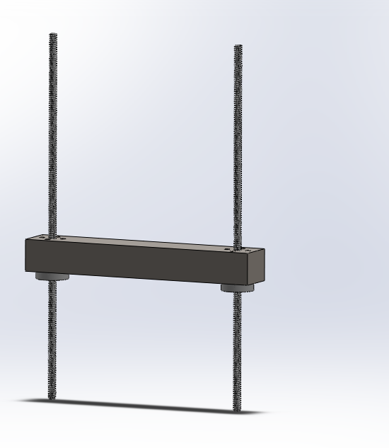

The upper and lower frame rails were added around the translating mechanism.

> **Figure 15 – Upper and lower frame rails added**

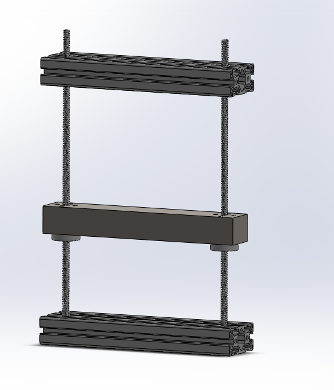

The vertical frame rails were added to establish the supporting structure.

> **Figure 16 – Vertical frame rails added**

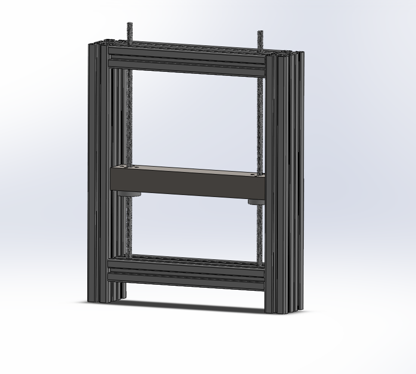

The base rails were added to complete the preliminary frame and CAD arrangement.

> **Figure 17 – Final preliminary tensile tester CAD assembly with base supports**

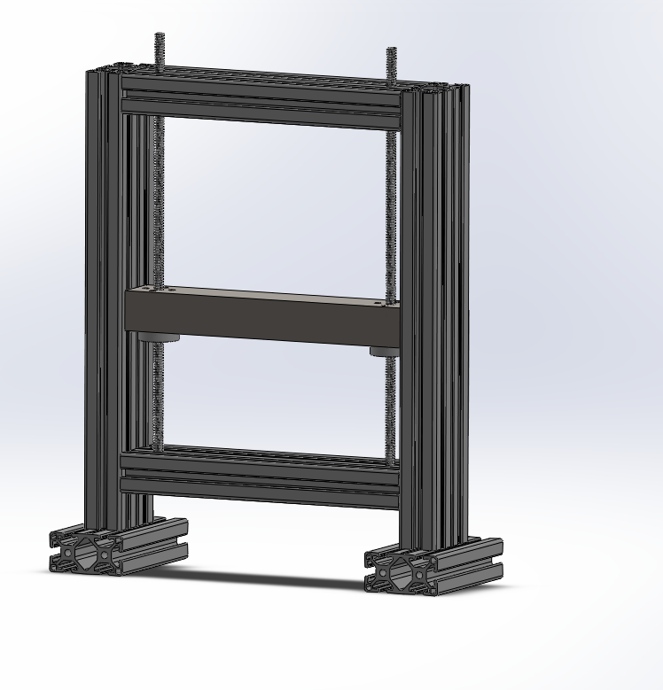

The final model represents the conceptual Part 1 assembly. Individual fasteners, detailed screw bearing supports, mechanical drive and synchronization hardware, and specimen grips are not fully modeled or verified. No physical load test or motion test is claimed. Before fabrication, the flange and screw fits, mounting strength, screw support arrangement, and synchronized operation must be confirmed.

### Engineering Lessons Learned – Team

Throughout this assignment, we learned how the lead screws, nuts and flanges, crosshead, and frame work together in a mechanically driven tensile tester. The lead screw analysis showed how axial stress determines the minimum screw diameter, how screw lead relates rotational speed to linear crosshead speed, and how friction influences the torque required to move the crosshead under load.

When selecting the nut and flange, we learned that matching the nominal thread diameter alone is not sufficient. Thread pitch, thread form, direction, number of starts, and material must also be considered. A compatible one-piece bronze flange nut was not found during our selection process, so a separate bronze nut and steel flange were selected. The nut analysis also showed why the 2 kN tensile load must be divided between the two lead screws under symmetric loading, and why calculated safety factors depend on the assumed material strength and effective thread engagement.

The crosshead analysis demonstrated that strength and stiffness are separate design requirements. Yield strength determines the allowable bending stress, while elastic modulus and the area moment of inertia influence deflection. Increasing the crosshead height can substantially improve stiffness, even when the applied load remains unchanged.

During CAD integration, we learned the importance of coordinating dimensions between team members. The selected nut and flange geometry determined the mounting features on the crosshead, while the lead screw length and spacing influenced the frame arrangement. The cost table also demonstrated how component selection affects the overall material cost. Together, these steps reinforced the importance of connecting engineering calculations, component compatibility, CAD geometry, and cost before moving toward fabrication. The assembly remains a conceptual design and has not been physically tested.

### Time Spent – A.C. Florencondia

**Actual time spent: 10 hours.**

---

## CAD Download

[Download A10 Tensile Machine SolidWorks Files](../../assets/files/A10_Tensile_Machine.zip)

---

## References

1. MEGR 2156/2157, Lead Screw System Design Part 1 assignment instructions.
2. *Machinery's Handbook*, 31st Edition, Simple Mechanisms—Screw, p. 178; Ball and Acme Lead Screws, pp. 2604–2643 (range referenced in the assignment).
3. McMaster-Carr, [93410A608 alloy steel Acme lead screw](https://www.mcmaster.com/93410A608/).
4. McMaster-Carr, [95072A127 precision Acme externally threaded nut](https://www.mcmaster.com/95072A127/).
5. McMaster-Carr, [95082A641 precision Acme flange](https://www.mcmaster.com/95082A641/).
