# A11 – Tensile Tester Part 2: Motor Selection and Design

**A11 team design portfolio — documented concept and simulation results.** The team developed motor/mount/coupler CAD, analyzed top and vertical frame members, designed a floating-bearing mounting plate, and produced a SolidWorks assembly rendering. The reported analyses are presented as completed modeling work; unresolved engineering checks are identified under Design Verification.

## Objective

The objective of this project is to design and develop a tensile testing machine capable of applying a maximum tensile load of **2 kN** to evaluate the mechanical properties of materials. The design incorporates a lead screw drive system, stepper motors, a structural frame, a movable crosshead, and appropriate mounting components to safely and effectively apply the required load.

The project involves selecting and sizing mechanical components, performing engineering calculations and free-body diagrams, evaluating structural integrity through finite element analysis (FEA), and creating a complete SolidWorks assembly. Each team member is responsible for specific portions of the design while collaborating on the final assembly, bill of materials, engineering costs, and project documentation.

### Team Responsibilities

| Member | Design and analysis contributions |
|---|---|
| **A.C. Florencondia** | Motor selection, geared drive sizing, motor bracket, shaft coupler, and drive subassembly |
| **Rebekah (Bekah) Smith** | Frame connection brackets, motor reaction loads, top-frame stress analysis and FEA |
| **Farima Pournia** | Vertical-column FEA, floating bearing mount, and combined SolidWorks assembly |

---

## Analyze

### Motor Selection and Drive System – A.C. Florencondia

**Responsibility:** Select and verify the drive motors, design the motor mounting bracket and shaft coupler, complete the supporting calculations, and create the motor/mount/coupler SolidWorks subassembly. **Budgeted contribution time:** 5.5 hours, adopting the midpoint of the 5–6-hour AC estimate in Rebekah's submitted team cost table.

#### Motor Selection

We retained the A10 two-lead-screw architecture, with **1,000 N of axial force per screw** under the total **2,000 N** tensile load. The selected motor candidate is the **[STEPPERONLINE 23HS22-2804S-HG10](https://www.omc-stepperonline.com/nema-23-stepper-motor-l-56mm-gear-ratio-10-1-high-precision-planetary-gearbox-23hs22-2804s-hg10)**, a NEMA 23 stepper with a **10:1 planetary gearbox**. Two identical geared motors are proposed, one for each lead screw.

> **Figure 1 – Motor, mounting bracket, and coupler SolidWorks subassembly – AC**

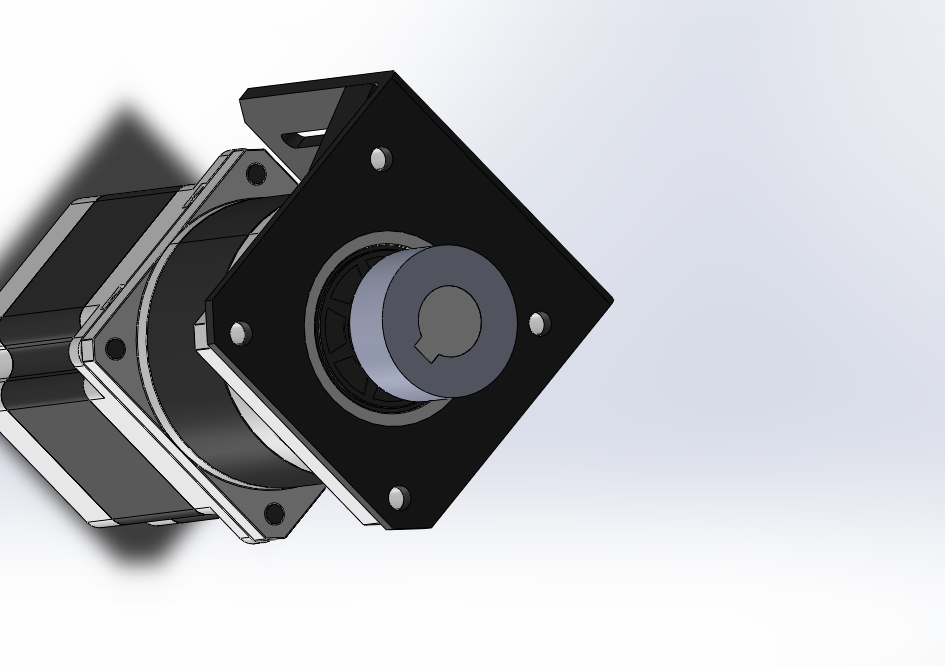

| Parameter | Selected or calculated value |
|---|---:|
| Total test load | 2,000 N |
| Axial load per screw | 1,000 N |
| Lead screw | 3/8-10 right-hand single-start Stub Acme; McMaster 93410A608 |
| Screw lead | 2.540 mm/rev |
| Crosshead travel speed | 1–50 mm/min |
| Lead screw output speed | 0.394–19.685 rpm |
| Geared motor internal speed | 3.94–196.85 rpm |
| Gear ratio / published gearbox efficiency | 10:1 / 92% |
| Phase current / winding resistance | 2.8 A/phase / 0.9 Ω |
| Manufacturer speed–torque test condition | 24 V driver, 2.8 A/phase, half-step |
| Motor holding torque before gearbox | 1.03 N·m (not running torque) |
| Maximum permissible gearbox output | 6.00 N·m |
| Target factor of safety | 4 |

**Free-body diagram.** The axial load of 1,000 N acts on the screw/nut system. A separate bearing arrangement must carry the screw thrust so the motor and coupler transmit **torque**, not the full axial test load.

> **Figure 2 – Idealized motor-to-lead-screw free-body diagram – AC**

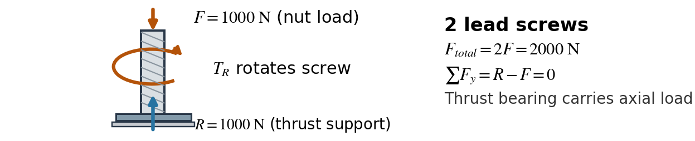

For the lead screw lead \(L=2.540\ \mathrm{mm/rev}\), the rotational speed requirement is:

\[
n_{screw}=\frac{v}{L}; \qquad
n_{min}=\frac{1}{2.540}=0.394\ \mathrm{rpm},\quad
n_{max}=\frac{50}{2.540}=19.685\ \mathrm{rpm}.
\]

Using the preliminary Acme-thread raising-torque model, \(d_m=8.763\ \mathrm{mm}\), coefficient of friction \(\mu=0.15\) (assumed), and half-angle \(\alpha=14.5^\circ\):

\[
T_R=\frac{Fd_m}{2}
\left(\frac{L+\pi\mu d_m\sec\alpha}{\pi d_m-\mu L\sec\alpha}\right)
\]

\[
T_R = 1098.81\ \mathrm{N\,mm}=1.099\ \mathrm{N\,m};\qquad
T_{design}=4T_R=\boxed{4.395\ \mathrm{N\,m}}.
\]

The estimated design torque is less than the manufacturer's **6.00 N·m maximum permissible gearbox output torque**. The published *pull-out* torque curve also lies above 6 N·m near the maximum required output speed of 19.685 rpm under the specified test conditions.

> **Figure 3 – Approximate reading of the manufacturer speed–torque curve; not measured test data – AC**

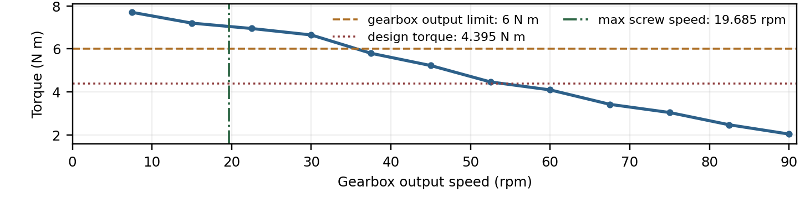

Source: [manufacturer's original speed–torque curve PDF](https://www.omc-stepperonline.com/download/23HS22-2804S-HG10_Torque_Curve.pdf). **Limitation:** the curve begins at 7.5 output rpm; it does not certify continuous-duty output at 0.394 rpm. The gearbox rating is an upper output limit, not an independently confirmed continuous rating. The friction coefficient and thrust-bearing torque are also not manufacturer-validated, so this selection is **preliminary**.

> **Figure 4 – Complete motor selection calculation sheet with FBD and equations – AC**

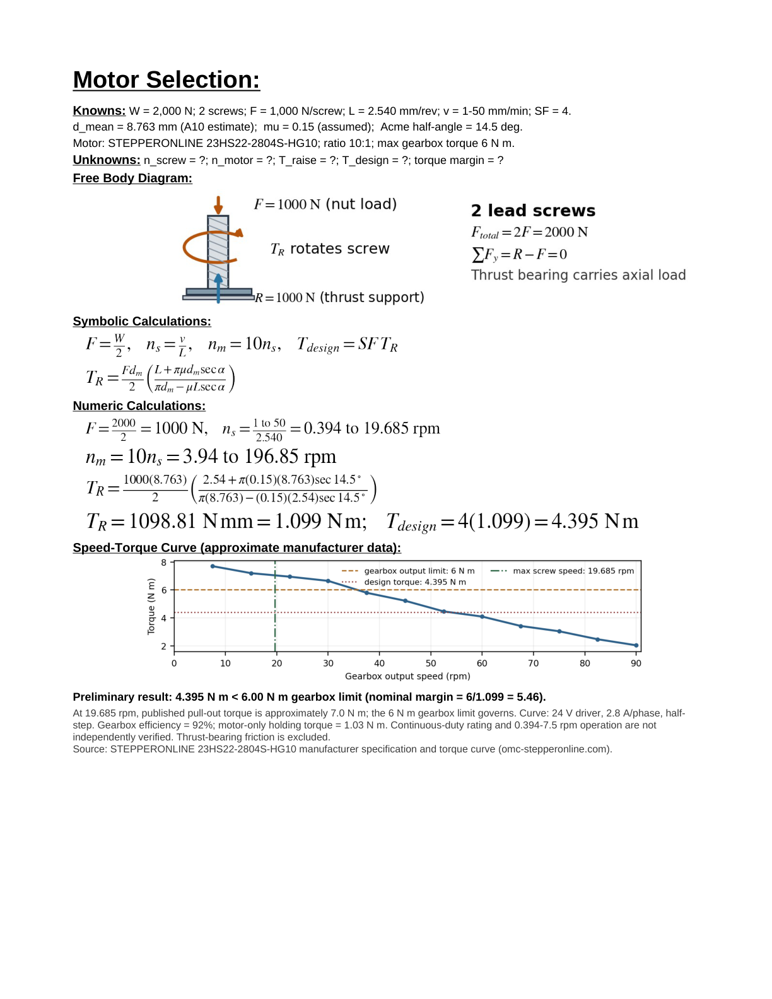

#### Motor Mount Design

The motor mount was modeled in SolidWorks as an **L-shaped, gusset-reinforced steel bracket**. The motor is attached with four mounting fasteners and the bracket is attached to the top T-slot framing using two elongated frame slots. During assembly fit-up, the frame interfered with an earlier mounting position; the bracket orientation was adjusted to place the vertical attachment leg alongside the top rail while preserving the motor and lead-screw centerline. The bracket's frame slots were revised to **5.5 mm width** for proposed M5 frame fasteners.

> **Figure 5 – Modeled motor mounting bracket – AC**

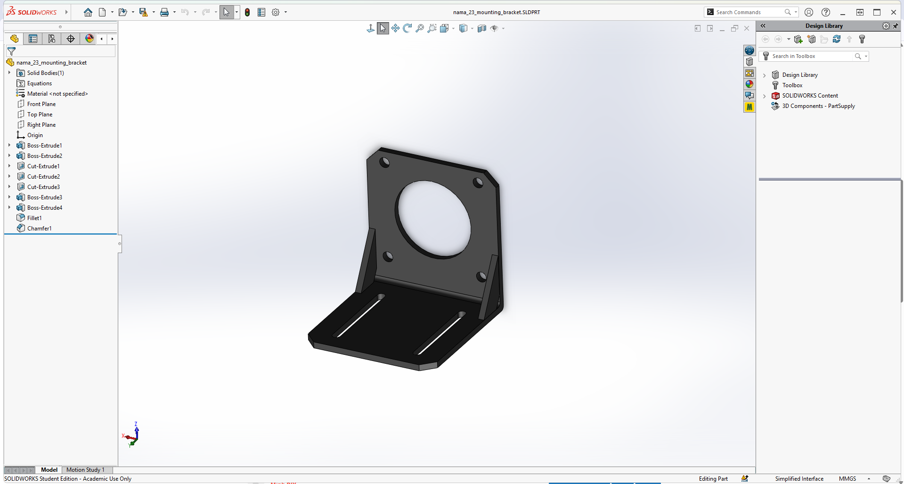

> **Figure 6 – Motor bracket fit beside the top frame rail – AC**

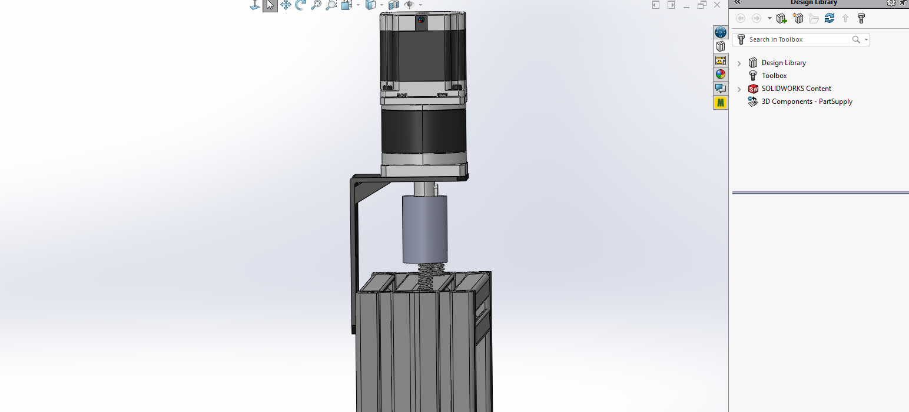

| Mount parameter | Value |
|---|---:|
| Material selected | ASTM A36 steel |
| Yield strength used | 250 MPa |
| Thickness | 3.00 mm |
| Motor hole pattern | Four Ø5.0 mm holes; 47 × 47 mm centers |
| Frame attachment | Two slots, width 5.5 mm; frame fasteners proposed as M5 |
| Approximate frame-fastener spacing | 39.1 mm |
| Triangular side gusset sketch | 25 mm long × 15 mm high |
| Conservative reaction torque for fastener check | 6 N·m |
| Required safety factor | 4 |

> **Figure 7 – Motor and frame bolt-group FBDs – AC**

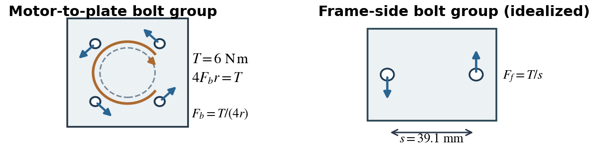

**Symbolic calculations.** For four equal torque-reaction forces at motor-bolt radius \(r\):

\[
r=\frac{a}{\sqrt{2}},\quad F_b=\frac{T}{4r},\quad
\sigma_{bearing}=\frac{F_b}{dt},\quad
\sigma_{allow}=\frac{S_y}{SF},\quad
t_{min}=\frac{F_b}{d\sigma_{allow}}.
\]

**Numerical calculations.** For \(a=47.0\ \mathrm{mm}\), \(T=6000\ \mathrm{N\,mm}\), \(d=5.0\ \mathrm{mm}\), \(t=3.0\ \mathrm{mm}\), and \(S_y=250\ \mathrm{MPa}\):

\[
r=33.23\ \mathrm{mm},\qquad F_b=\frac{6000}{4(33.23)}=45.13\ \mathrm{N}.
\]

\[
\sigma_{allow}=\frac{250}{4}=62.50\ \mathrm{MPa},\quad
\boxed{t_{min}=0.144\ \mathrm{mm}},\quad
\boxed{\sigma_{bearing}=3.01\ \mathrm{MPa}}.
\]

Thus, the **3 mm bracket passes the simplified motor-hole bearing check**. For a two-bolt frame-attachment reaction couple with \(s=39.1\ \mathrm{mm}\), the equivalent reaction magnitude is \(F_f=T/s=153.45\ \mathrm{N}\) per fastener. The nominal stress estimate using an M5 fastener area is low, but actual joint shear versus tension, preload, local prying, slot bearing and T-nut behavior remain subject to the final mount orientation and bolt selection.

A simplified **motor self-weight** bending check using \(F=16\ \mathrm{N}\), \(\ell=46.16\ \mathrm{mm}\), \(b=65\ \mathrm{mm}\), \(t=3\ \mathrm{mm}\) gives \(\sigma_b\approx7.57\ \mathrm{MPa}\) and \(\delta\approx0.018\ \mathrm{mm}\). This idealized beam model does not capture the frame joint compliance, cutouts and complete gusset geometry. The **bearing requirement** has a calculated minimum thickness of 0.144 mm; this is not a minimum for overall bracket stiffness or strength.

**CAD fit detail:** The four motor holes in the uploaded bracket STEP are nominal **Ø5.0 mm**. Proper clearance for the actual motor fasteners should be verified and adjusted if needed before fabrication.

> **Figure 8 – Complete motor mounting bracket calculations – AC**

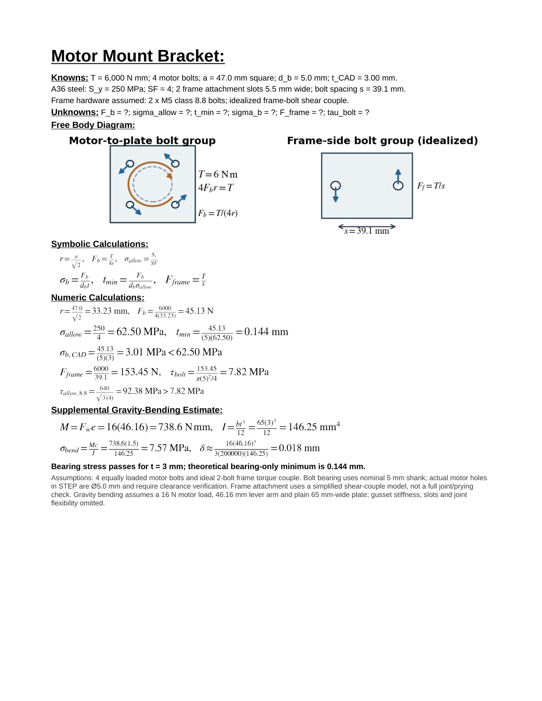

#### Coupler Design

We modeled a cylindrical, unequal-bore coupler to join the geared motor's **Ø14 mm keyed shaft** to the **nominal Ø9.525 mm (3/8 in) lead screw**. The motor end has a matching keyway; the lead-screw end has a radial **M5 × 0.8 tapped set-screw hole**, located approximately **10 mm** from that end, intended to press on a shallow flat modeled near the end of the screw.

> **Figure 9 – Custom coupler body – AC**

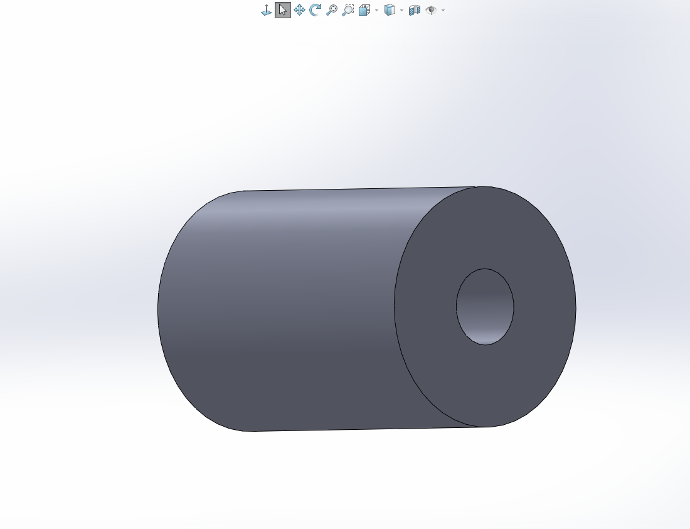

> **Figure 10 – Coupler and keyed motor shaft aligned in assembly – AC**

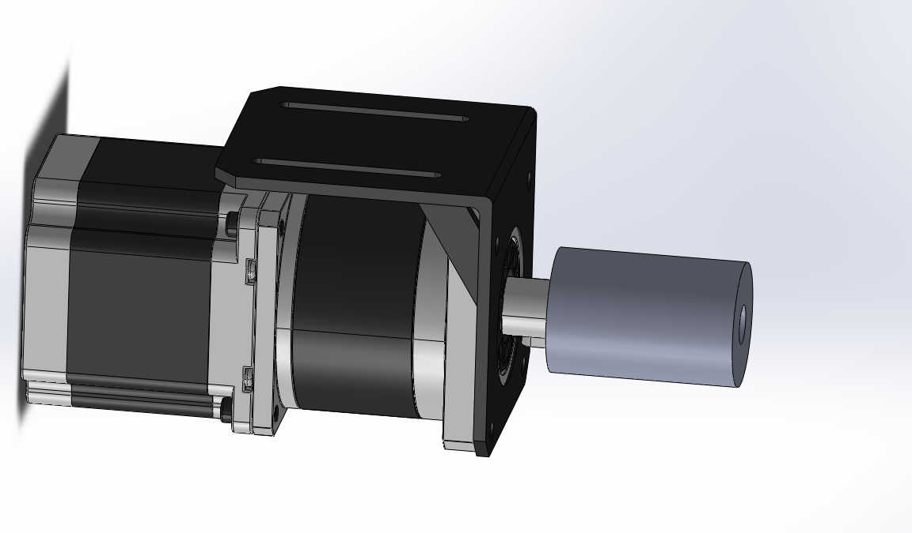

| Coupler parameter | Designed value |
|---|---:|
| Body material | 6061-T6 aluminum |
| Yield strength used | 240 MPa (conservative preliminary value) |
| Body outside diameter / length | Ø30 mm / 45 mm |
| Motor-side bore / depth | Ø14 mm / 20 mm |
| Lead-screw-side bore / depth | Ø9.525 mm / 20 mm |
| Motor-side feature | Internal keyway |
| Lead-screw-side feature | One M5 × 0.8 radial tapped hole |
| Proposed shaft contact | Shallow flat, approximately 0.030 in (0.762 mm) deep |
| Torsion load used for coupler body | 6.00 N·m |
| Required factor of safety | 4 |

> **Figure 11 – Shaft coupler torsion FBD – AC**

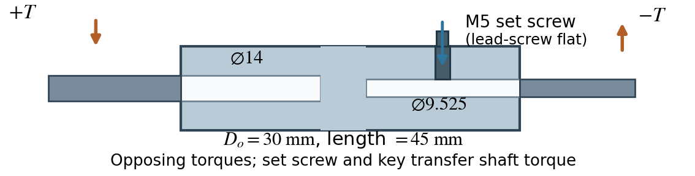

For a hollow circular section, using the larger Ø14 mm bore as the critical minimum section, the polar moment and maximum torsional shear stress are:

\[
J=\frac{\pi}{32}(D_o^4-D_i^4),\qquad
\tau_{max}=\frac{16TD_o}{\pi(D_o^4-D_i^4)}.
\]

With \(S_y=240\ \mathrm{MPa}\), \(SF=4\), the von Mises allowable shear estimate is:

\[
\tau_{allow}=\frac{S_y}{\sqrt{3}\,SF}=34.64\ \mathrm{MPa}.
\]

For \(T=6000\ \mathrm{N\,mm}\) and \(D_i=14\ \mathrm{mm}\), setting \(\tau_{max}=\tau_{allow}\) gives an **idealized** minimum outer diameter of:

\[
\boxed{D_{o,min}=15.08\ \mathrm{mm}}.
\]

Our selected \(D_o=30\ \mathrm{mm}\) gives:

\[
\boxed{\tau_{max}=\frac{16(6000)(30)}{\pi(30^4-14^4)}=1.188\ \mathrm{MPa}<34.64\ \mathrm{MPa}}.
\]

**Result:** The Ø30 mm coupler body exceeds the **bulk torsional shear** requirement. The simple circular-shaft calculation does **not** account for the motor keyway's stress concentration, set-screw-hole weakening, or the actual shaft/fastener contact conditions.

> **Figure 12 – Full coupler design and torsional calculations – AC**

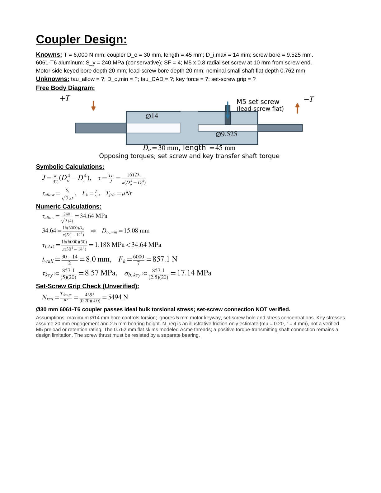

> **Figure 13 – Shallow contact flat on modeled lead screw – AC**

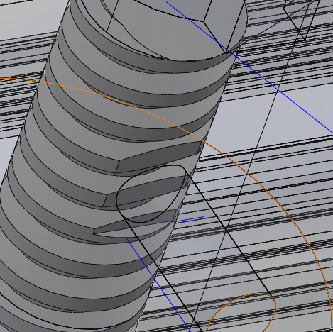

**Connection limitation:** For a one-set-screw friction-only model, a preliminary coefficient \(\mu=0.20\) and effective radius \(r\approx4\ \mathrm{mm}\) imply a normal force of approximately \(5.5\ \mathrm{kN}\) to transfer the **4.395 N·m design torque**: \(N=T/(\mu r)\). This preload, the clamping ability of the M5 screw in aluminum, and the contact behavior on a shallow *threaded* flat are **not verified**. The torsional safety result above therefore cannot be used to claim that the finished coupler-to-lead-screw connection passes SF = 4.

**Component compatibility:** Motor keyway fit, motor-bolt clearance, set-screw torque rating, and the final thrust-bearing load path remain final fit and design checks before any physical build.

### Frame Connections, Bracket Design, and Top Frame FEA – Bekah

**Design responsibilities:** Structural frame connections, motor twisting analysis, mounting bracket design, and top-frame structural verification.

The objective of this portion is to design and analyze the structural connections between the vertical supports and the top frame. The frame must support the tensile load while maintaining sufficient strength and stiffness to prevent excessive bending, twisting, or deformation. Hand calculations and free-body diagrams are used to determine the connection forces; SolidWorks Simulation is used to examine stress, displacement, factor of safety, and mesh convergence.

#### Known and Unknown Variables

The design begins with the selected frame geometry, maximum applied load, motor information, and a required factor of safety of **4**. Bekah's original known-and-unknown table is shown below.

> **Figure 14 – Frame connection analysis: known and unknown variables – Bekah**

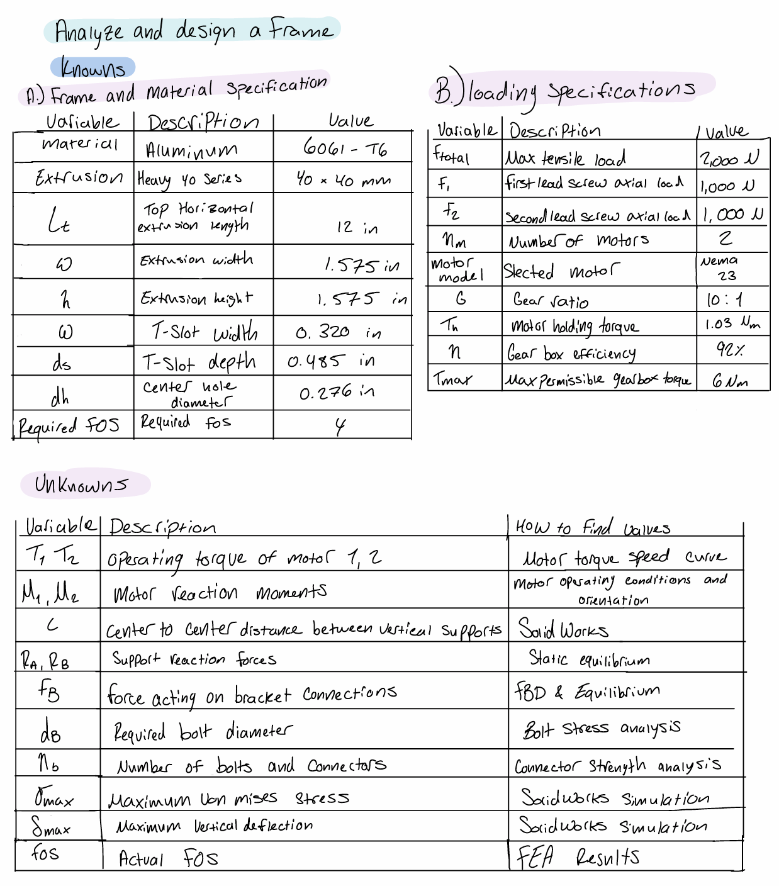

#### Frame Connections and Motor Twisting

The tensile tester uses two motors above its vertical lead screws, with the motor shafts oriented downward. The team draft identifies a **9.62 in** spacing between the motor and vertical support locations. Under the assumed symmetric load distribution, each lead screw carries **1,000 N** of the **2,000 N** total tensile load.

The lead screws transfer axial forces into the top frame and vertical supports. Motor reaction torque also acts on the mounting connections and may introduce twisting or warping, so the axial load and applied moments must both be considered.

**Motor specifications used in the frame analysis**

| Motor property | Value |
|---|---:|
| Selected motor | STEPPERONLINE 23HS22-2804S-HG10 |
| Motor holding torque | 1.03 N·m |
| Gear ratio | 10:1 |
| Gearbox efficiency | 92% |
| Theoretical torque from holding value | 9.476 N·m |
| Maximum permissible gearbox output torque | 6.00 N·m |
| Phase current | 2.8 A |
| Phase resistance | 0.9 Ω |
| Gearbox backlash | ≤30 arcmin |

The theoretical gearbox output torque is calculated as

\[
T_{\mathrm{out}}=T_{\mathrm{motor}}G\eta
=1.03(10)(0.92)=9.476\ \mathrm{N\cdot m}.
\]

However, the gearbox's **6 N·m maximum permissible output torque** governs. The 1.03 N·m motor figure is *holding torque*, not confirmed operating torque; final applied reaction moments need to reflect the verified operating or design condition.

> **Figure 15 – Free-body diagrams and handwritten motor/frame reaction calculations – Bekah**

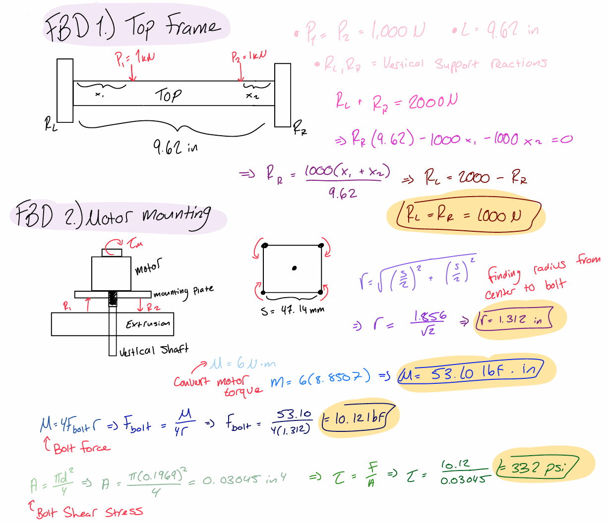

For the top frame, the draft starts from static equilibrium:

\[
\sum F_x=0,\qquad \sum F_y=0,\qquad \sum F_z=0
\]

\[
\sum M_x=0,\qquad \sum M_y=0,\qquad \sum M_z=0.
\]

For a simplified symmetric vertical loading case, the handwritten FBD shows:

\[
R_L+R_R-1000-1000=0
\]

\[
\boxed{R_L=R_R=1000\ \mathrm{N}}.
\]

The accompanying motor mounting FBD considers the **6 N·m** gearbox torque and its equivalent reactions at the mounting fasteners.

#### Frame Connection Bracket Selection

For the structural connection between the vertical supports and the top 40-series T-slot extrusion, the draft selects the **McMaster-Carr 5537T348 90-degree extended corner bracket**. This is the **frame connection bracket**, not AC's separately modeled motor mounting bracket.

The selected bracket is described as powder-coated **6063-T5 aluminum**, supplied with **M8 mounting hardware**.

> **Figure 16 – Selected frame connection bracket and handwritten dimensions – Bekah**

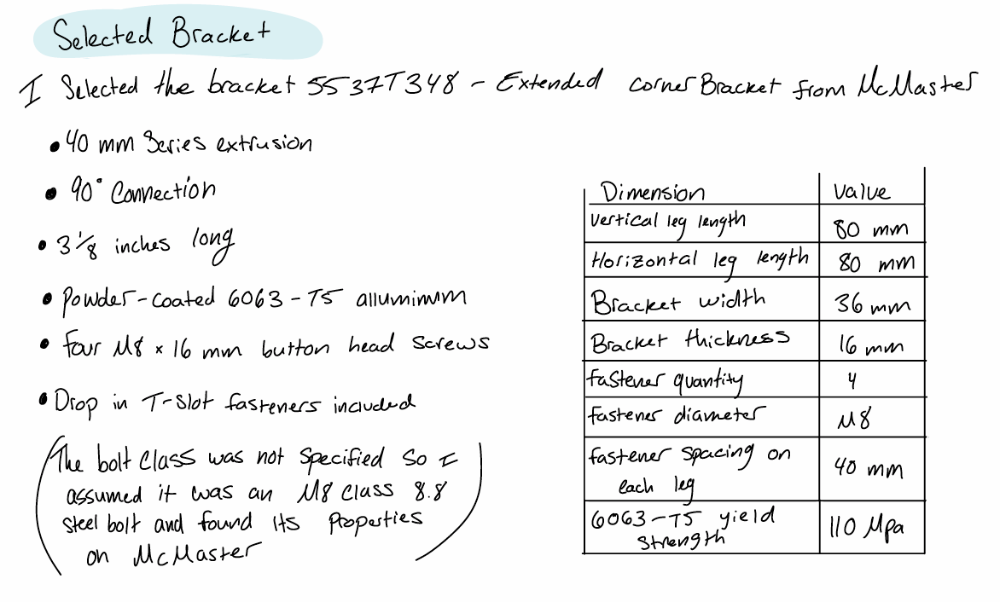

> **Figure 17 – Frame connection bracket CAD representation – Bekah**

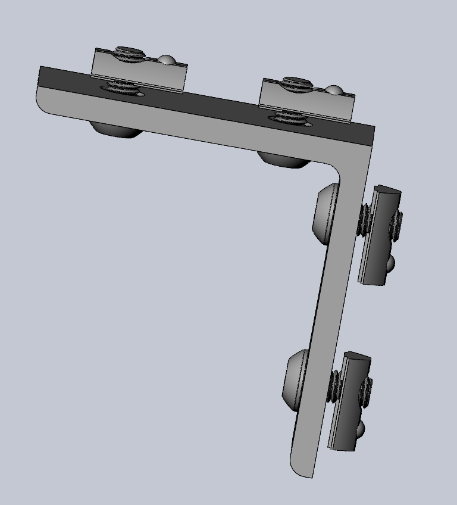

#### Connection Bracket Free-Body Diagram and Stress Checks

The connection bracket must transfer forces and moments from the frame into the bolt group and T-slot extrusion. Bekah's FBD and hand calculations examine the mounting reactions and fastener stresses.

> **Figure 18 – Connection bracket free-body diagram, equilibrium, and fastener calculations – Bekah**

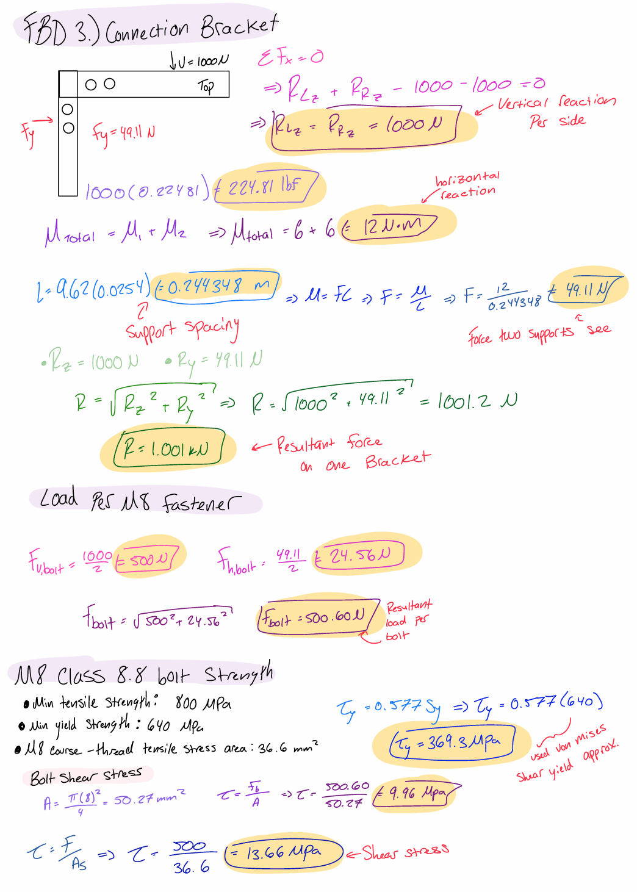

For a simplified rectangular bracket section with width \(b\), thickness \(t\), and applied bending moment \(M\):

\[
M=FL,\qquad S=\frac{bt^2}{6},\qquad \sigma_b=\frac{M}{S}.
\]

Bolt shear, bolt tension, bearing, and edge tear-out are evaluated using:

\[
\tau_{\mathrm{bolt}}=\frac{F_s}{A_s},\qquad
\sigma_t=\frac{F_t}{A_t},\qquad
\sigma_{\mathrm{bearing}}=\frac{F}{td}.
\]

\[
A_{\mathrm{tear}}\approx 2te,\qquad
\tau_{\mathrm{tear}}=\frac{F}{2te},\qquad
FOS=\frac{S_y}{\sigma}.
\]

Here, \(e\) is the net distance from the bolt-hole edge to the bracket edge. The rectangular-section model is a preliminary approximation and does not capture every detail of the formed bracket or actual T-slot connection.

> **Figure 19 – Bracket bearing, tear-out, bending, and factor-of-safety calculations – Bekah**

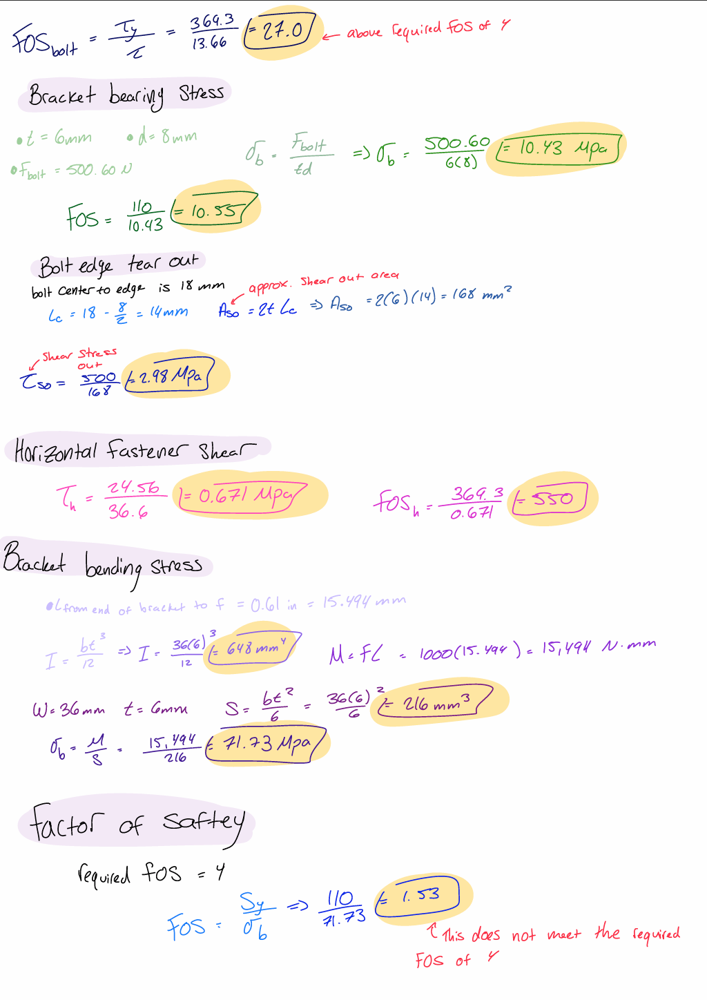

**Result requiring review:** The handwritten bending analysis gives a bracket stress of **71.73 MPa** and a nominal factor of safety of **1.53** using \(S_y=110\ \mathrm{MPa}\):

\[
FOS_{\mathrm{bending}}=\frac{110}{71.73}=\boxed{1.53}.
\]

This is **below the required factor of safety of 4**. The team's design response and final bracket verification are therefore still pending. Other fastener and bearing checks appear in the original calculations; they should not be used to override the governing lower bending safety factor.

#### Top Frame Structural Analysis

The current top-frame design is a **12 in long, 40-series T-slot aluminum extrusion**. The draft uses the following geometry and preliminary material properties:

| Specification | Draft value |
|---|---:|
| Extrusion series | 40 Series |
| Material | 6061-T6 aluminum |
| Cross section | 1.575 in × 1.575 in |
| Length | 12 in |
| Slot width | 0.320 in |
| Slot depth | 0.485 in |
| Center hole diameter | 0.276 in |
| Motor/support spacing | 9.62 in |
| Yield strength used | 35,000 psi |
| Elastic modulus | 10,000,000 psi |
| Poisson's ratio | 0.33 |

Using the required factor of safety of 4, the preliminary allowable stress is:

\[
\sigma_{\mathrm{allow}}=\frac{S_y}{FOS}
=\frac{35{,}000}{4}
=\boxed{8{,}750\ \mathrm{psi}}.
\]

SolidWorks Simulation was used to examine the top extrusion under the team's frame constraints and applied loading. The draft includes screenshots of the von Mises stress distribution, displacement distribution, and factor-of-safety result.

> **Figure 20 – SolidWorks top-frame von Mises stress plot – Bekah**

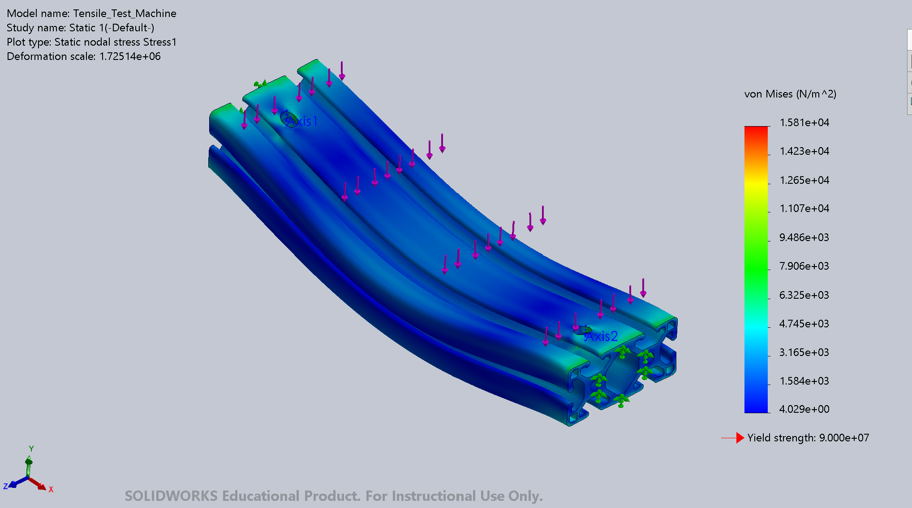

> **Figure 21 – SolidWorks top-frame displacement plot – Bekah**

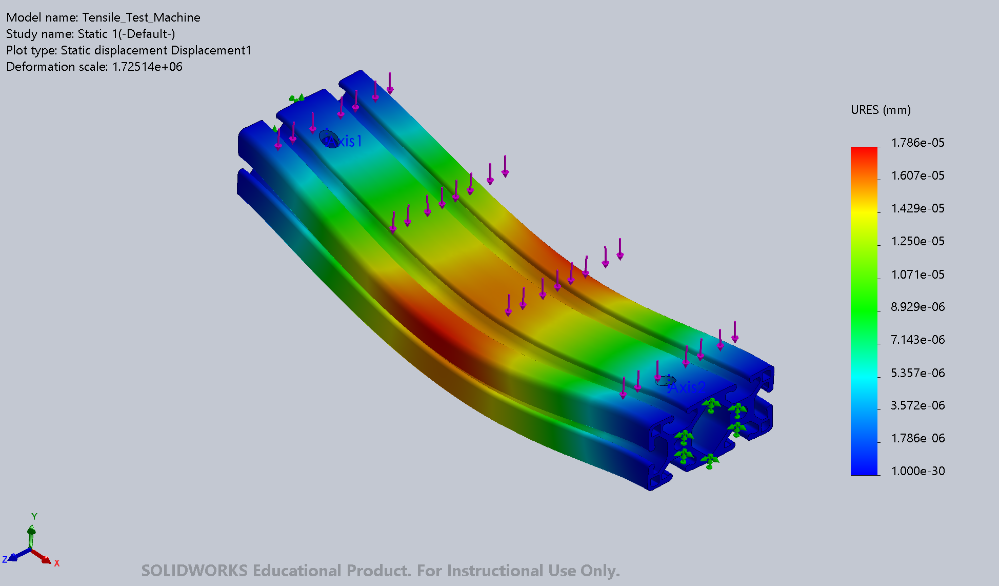

> **Figure 22 – SolidWorks top-frame factor-of-safety plot – Bekah**

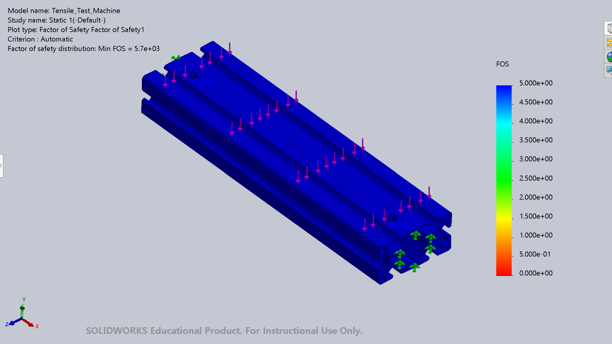

The draft identifies stress concentration, deflection, and motor-induced twisting as the key behaviors to assess. **Final FEA values, boundary-condition validation, and mesh-convergence interpretation still require team review** before the results can be presented as a verified structural pass.

#### Potential Design Improvements

The current team draft identifies several possible improvements following the hand calculations and FEA: changing bracket configuration or thickness, reducing the load-to-connection moment arm, adjusting frame-support spacing, adding reinforcement, or revising motor mounting to reduce transmitted moments. These are **proposed changes**, not completed redesigns or verified optimization results.

### Vertical Frame FEA, Floating Bearing Mount and Final Assembly – Farima Pournia

**Design responsibilities:** Evaluate the vertical frame under axial and transverse loading; create the floating-bearing mounting plate; and combine the team's CAD into a tensile-tester assembly.

#### Vertical Frame Structural Analysis

Farima isolated a vertical member of the tensile-tester frame in SolidWorks Simulation and assigned **6063-T4 aluminum** as the analysis material. The reported study uses a **2,000 N axial compressive load** at the upper end, a side-directed motor reaction load described in the team's PDF as “6 N torque,” and a fixed restraint at the bottom of the member. The loading is recorded as Farima modeled it; the intended 6 N·m motor torque must be applied as a *moment*, not as a 6 N force, if the study is repeated.

> **Figure 23 — Vertical-column loading and fixed-base boundary conditions — Farima**

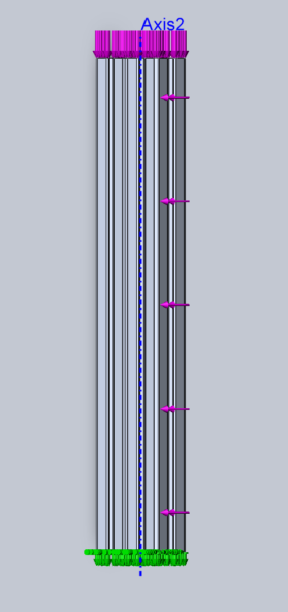

> **Figure 24 — Initial-mesh column and applied loads — Farima**

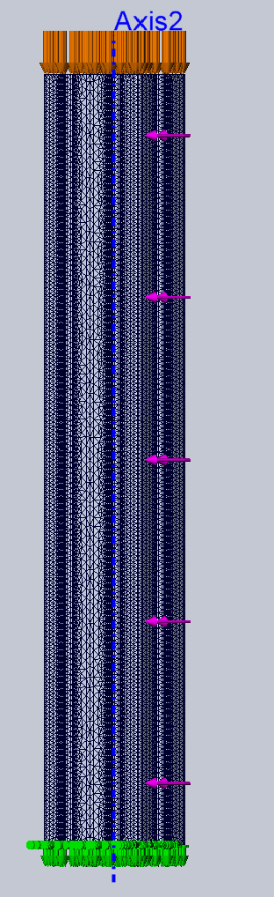

The analysis was repeated with a finer mesh to examine result convergence. The report identifies the lower region of the column as the area of elevated von Mises stress and the top region as the location of maximum displacement. The plotted values are summarized below. **The values are taken from the SolidWorks plot legends; some numbers differ from the approximate figures quoted in the team's written narrative.**

| Vertical-column result | First mesh | Finer mesh |
|---|---:|---:|
| Maximum von Mises stress, from plot legend | 7.471 MPa | 7.509 MPa |
| Maximum resultant displacement, from plot legend | ≈0.140 mm | ≈0.140 mm |
| Factor-of-safety display | Blue throughout; FOS above plot threshold of 4 | Blue throughout; FOS above plot threshold of 4 |
| Stress change relative to first mesh | — | ≈0.51% |

The maximum stress change between the two plotted mesh results is:

\[
\frac{|7.509-7.471|}{7.471}\times100\%=\boxed{0.51\%}.
\]

This is evidence of **stress-result convergence between the two supplied meshes for the modeled case**, but it does not independently validate the load definition, attachment conditions, or design material.

> **Figure 25 — Initial mesh: von Mises stress — Farima**

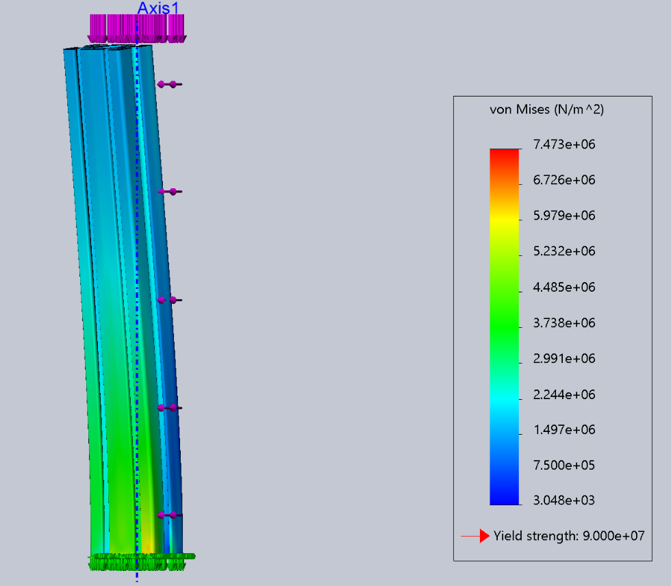

> **Figure 26 — Initial mesh: resultant displacement — Farima**

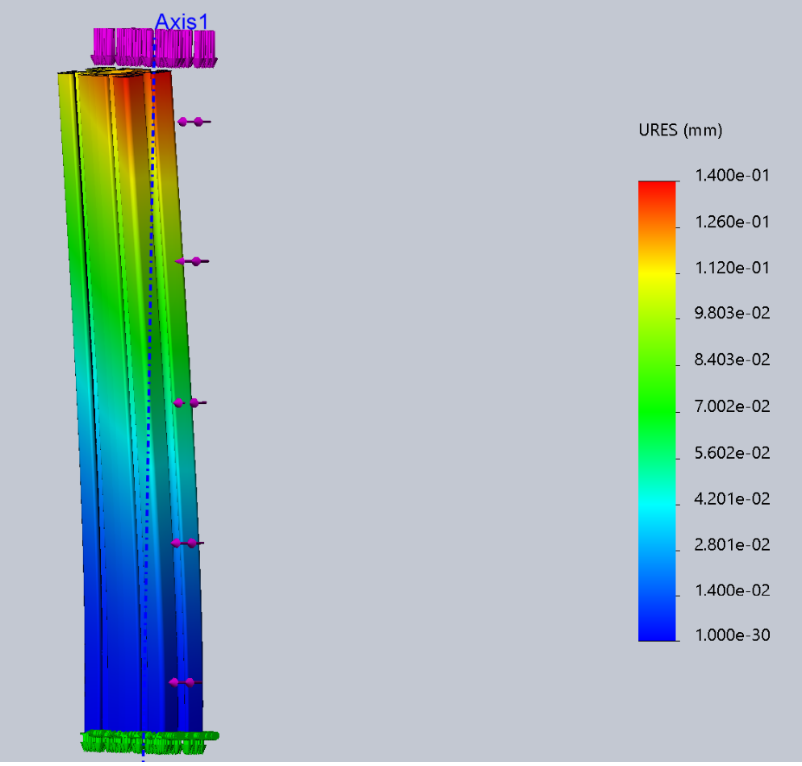

> **Figure 27 — Initial mesh: factor-of-safety threshold plot — Farima**

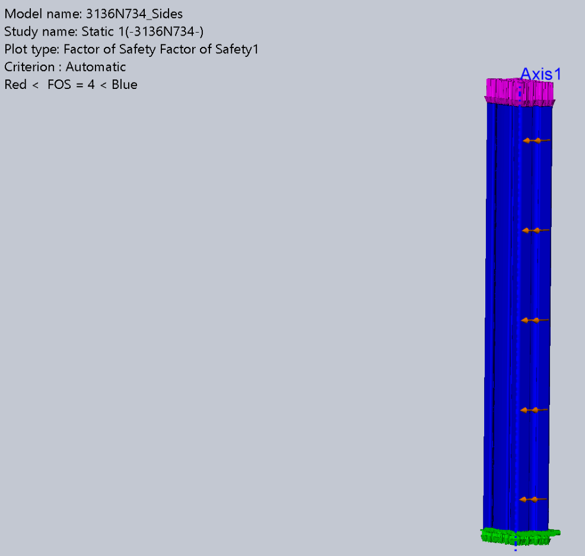

> **Figure 28 — Refined mesh configuration — Farima**

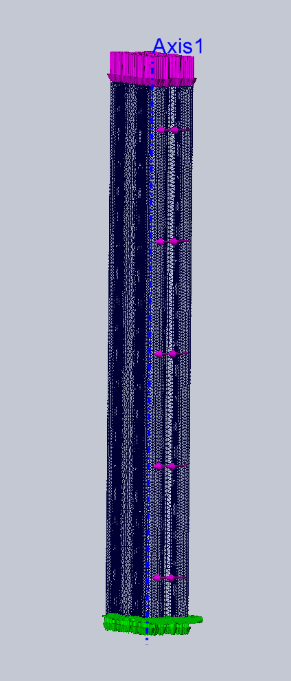

> **Figure 29 — Refined mesh: von Mises stress — Farima**

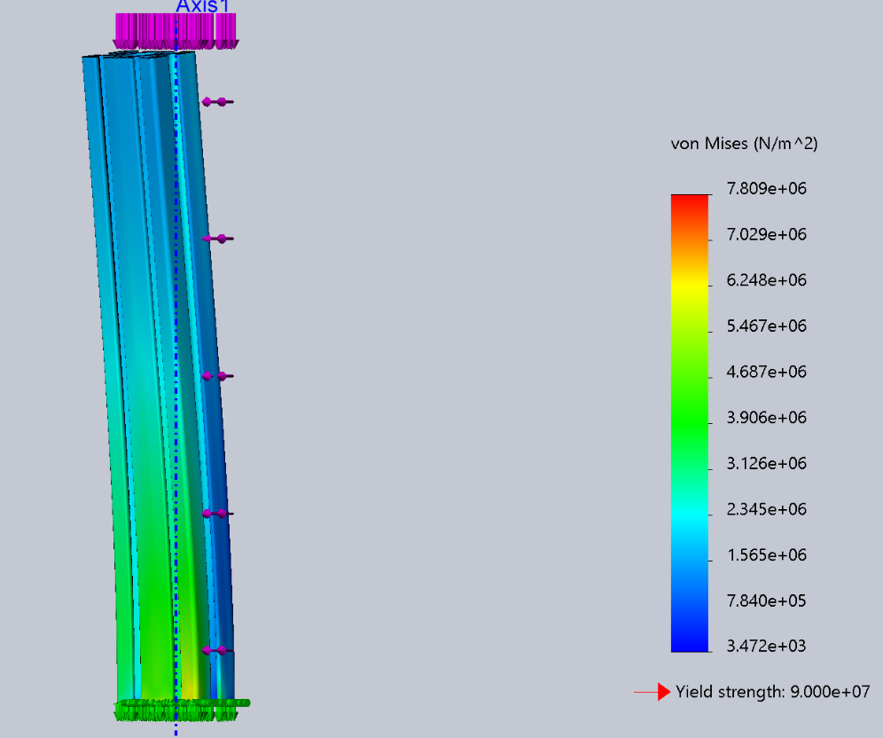

> **Figure 30 — Refined mesh: resultant displacement — Farima**

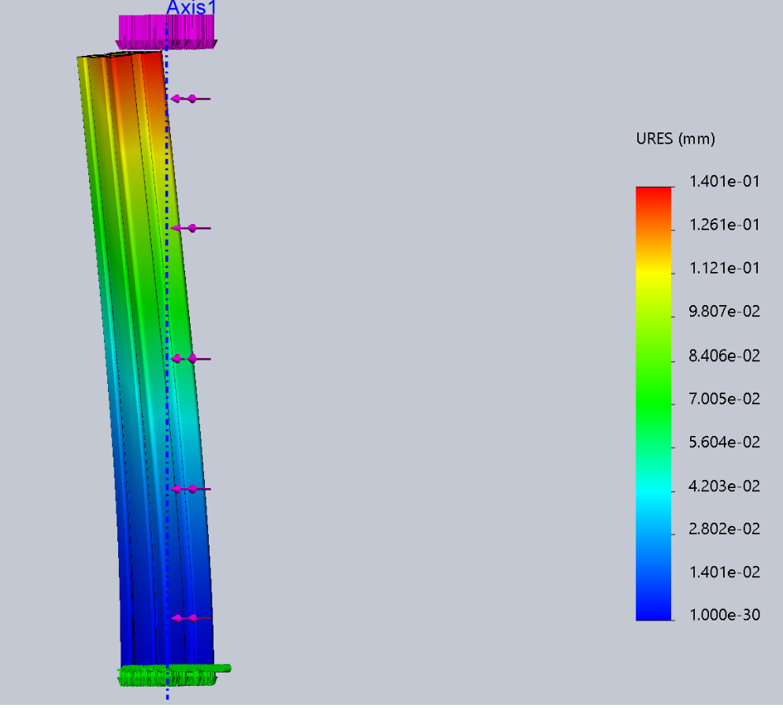

> **Figure 31 — Refined mesh: factor-of-safety threshold plot — Farima**

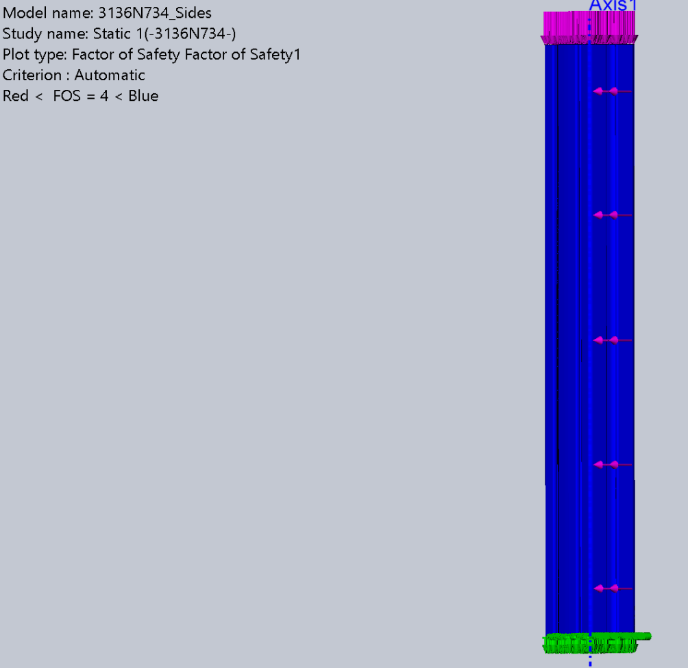

The similar stress and displacement patterns in the two simulation runs were used to assess the stability of Farima's results. She also observed visible twisting of the model under lateral loading. The deformed shape is **exaggerated by SolidWorks for visualization** and must not be interpreted at its rendered scale as a physical displacement. Farima proposed adding thicker flange pads or localized reinforcement near the upper load-transfer region to improve stiffness.

#### Floating Bearing Mount

The lower lead-screw support was modeled as a flat mounting plate to fasten to the T-slot structure. Farima's drawing identifies an overall size of **3.0 × 2.0 in**, thickness **0.25 in**, four **Ø0.20 in** mounting holes for nominal #10 hardware, and a **Ø0.30 in** center opening with a stated **±0.0005 in** tolerance.

> **Figure 32 — Floating-bearing mounting plate and dimensions — Farima**

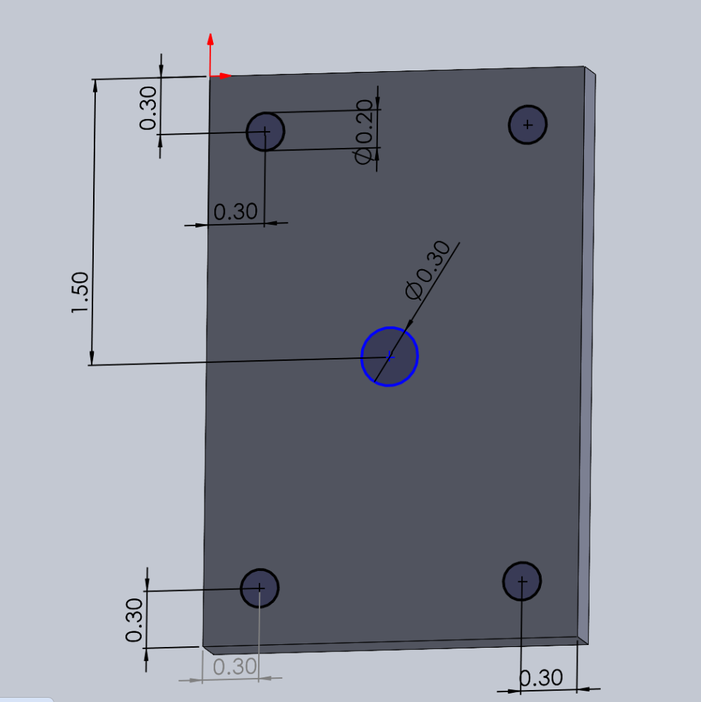

The floating bearing should provide radial guidance while allowing appropriate axial freedom, whereas the separate thrust-bearing arrangement must react the lead-screw axial loading. **Fit note:** the drafted Ø0.30 in center opening is smaller than the nominal **3/8 in (0.375 in)** screw outside diameter; it can only serve as the actual support interface if the screw end is reduced, a matching bearing is specified, or the plate hole is redesigned. The stated tolerance alone does not establish an RC3 running fit without compatible shaft and bearing dimensions.

#### Full CAD Assembly

Farima combined the team's drive components and T-slot framing into the overall tensile-tester concept, including two motors at the top, parallel lead screws, a crosshead, vertical support members and base feet.

> **Figure 33 — SolidWorks tensile-tester assembly — Farima**

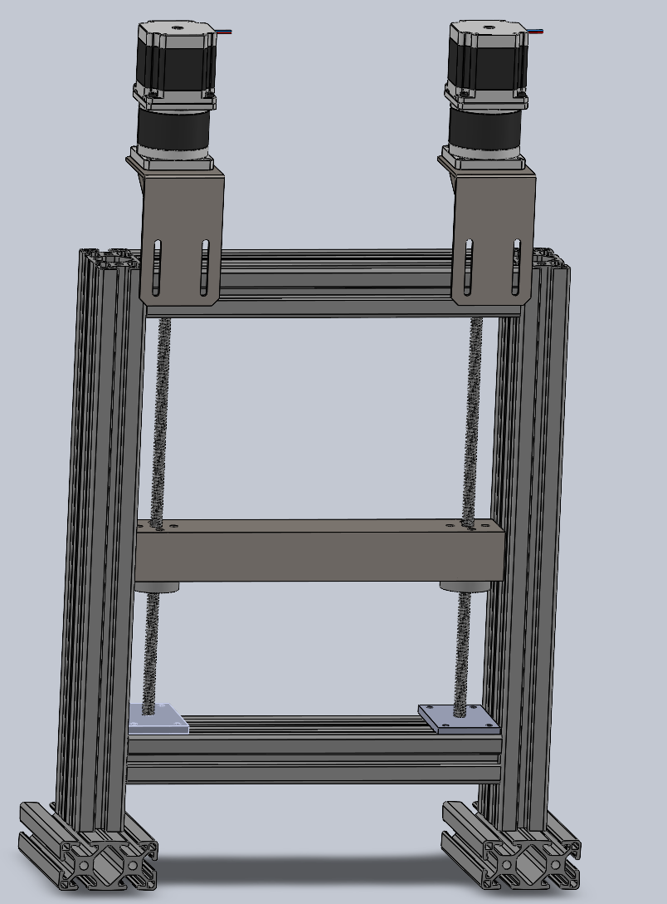

**Documented time:** Farima reported **5 hours** for her A11 contributions. Rebekah separately reported **6 hours** for her frame-analysis portion. The latest team PDF includes the assembly rendering, but **not the native complete-assembly CAD ZIP** or a validated manufacturing package.

---

## Decide

### Selected Mechanical Configuration

The team retained the **two-screw, 2 kN conceptual tensile tester** established in A10. The drive uses two provisional **STEPPERONLINE 23HS22-2804S-HG10** 10:1 geared NEMA 23 motors, one per screw. Each motor's shaft is coupled to a **3/8-10 Stub Acme lead screw** through a custom **Ø30 × 45 mm 6061-T6 aluminum coupler**. AC modeled the motor subassemblies and a gusseted **3 mm A36 steel** bracket that attaches beside the upper T-slot rail. The simplified bolt-bearing and coupler-body torsional calculations support their nominal sizes; the motor continuous-duty torque and one-set-screw torque-transfer capacity remain unverified.

For the structural system, Bekah selected **40-series T-slot framing** and **McMaster-Carr 5537T348** extended corner connections. Her hand analysis and SolidWorks top-frame study document the loading and expected areas of stress and deflection. Her own bracket-bending calculation reports **FOS = 1.53**, which is lower than the required four. Therefore, the frame corner bracket **cannot be treated as fully approved at SF = 4** on the present calculation; reinforcement or a revised load model would be necessary before manufacturing.

Farima investigated vertical-column loading using two simulation meshes, developed a floating-bearing mounting plate, and produced the complete concept assembly rendering. The plot legends show similar column peak stress and displacement for both meshes. Her plate design establishes mounting geometry but requires a bearing/shaft fit check at its 0.30 in opening.

### Design Verification and Limitations

| Requirement or interface | Documented outcome | Qualification |
|---|---|---|
| 2 kN test load | Design load defined and divided among two lead screws | Not a physical tensile test |
| 1–50 mm/min crosshead speed | Screw output speed calculated as 0.394–19.685 rpm | Motor operation below available torque-curve range needs confirmation |
| Motor design torque | 4.395 N·m per drive, including SF = 4 | Gearbox has 6 N·m max permissible torque, not certified continuous torque |
| Motor mount bearing strength | 3 mm A36 bracket passes simplified local bearing check | Frame-side bolt preload, prying and joint stiffness not fully modeled |
| Coupler bulk torsion | Ø30 mm 6061-T6 body passes idealized torsion check | Keyway and set-screw connection not fully verified |
| Top frame bending and connection | FEA screenshots and hand analysis included | Bracket bending FOS = 1.53; FEA material/load assumptions require reconciliation |
| Vertical frame FEA | Two meshes show ≈0.51% difference in plotted peak stress | Axial loading and “6 N torque” setup should be checked |
| Floating bearing support | Plate CAD and dimensions supplied | Ø0.30 in opening requires correct shaft-end and bearing dimensions |
| Full assembly | Two-motor SolidWorks assembly rendering supplied | Native complete assembly CAD archive was not included in the submitted source PDF |

The **top-frame FEA screenshot lists a material yield strength of 90 MPa**, whereas the accompanying written material specification uses **6061-T6, approximately 241 MPa**. The discrepancy matters for interpreting the reported factor of safety and should be reconciled with the actual SolidWorks material assignment. The plotted top-frame deformation is highly magnified; its displayed shape is not a full-scale physical deflection.

These limitations distinguish a **documented conceptual CAD and FEA design** from a fabricated or fully validated 2 kN testing machine.

---

## Communicate

### Engineering Documentation and CAD

The portfolio records the design contributions documented in the current team submission: AC's motor calculations, bracket and coupler CAD; Bekah's frame connector selection, handwritten load/stress calculations, and top-frame FEA; and Farima's two-mesh vertical-frame FEA, floating-bearing plate drawing, and integrated tensile-tester assembly rendering. The full-size numbered PNGs preserve the equations, drawing annotations, and simulation legends.

**Available component CAD files:** [Download supplied A11 STEP files](../../assets/files/A11_Available_Component_CAD.zip) (revised motor bracket, modeled coupler, and modified lead screw). This ZIP is **not** Farima's complete SolidWorks assembly; the original `Tensile_Test_Machine.SLDASM` and its referenced parts should be included in the team deliverable separately if required by the rubric.

### Bill of Materials and Engineering Cost

The cost summary below incorporates the **A10 purchased-component baseline** and the new A11 additions documented in Rebekah's submitted portfolio. The team submission reports **four McMaster 5537T348 frame brackets at $13.21 each** and **two STEPPERONLINE geared motors at $79.94 each**. Those A11 additions have a **documented subtotal of $212.72**, not the cost of the complete machine. A10 component costs were taken from the earlier project cart. All amounts are in USD, excluding taxes and shipping; prices are source-specific and may change.

| Component / source | Quantity | Unit price | Extended cost |
|---|---:|---:|---:|
| [93410A608 — B7 3/8-10 Stub Acme lead screw](https://www.mcmaster.com/93410A608) | 2 | $75.50 | $151.00 |
| [95072A127 — bronze Acme nut](https://www.mcmaster.com/95072A127) | 2 | $29.91 | $59.82 |
| [95082A641 — steel nut flange](https://www.mcmaster.com/95082A641) | 2 | $37.06 | $74.12 |
| [3136N735 — horizontal T-slot rail](https://www.mcmaster.com/3136N735) | 2 | $21.54 | $43.08 |
| [3136N734 — vertical T-slot rail](https://www.mcmaster.com/3136N734) | 2 | $31.02 | $62.04 |
| [3136N733 — base T-slot rail](https://www.mcmaster.com/3136N733) | 2 | $11.20 | $22.40 |
| **A10 documented component subtotal** | | | **$412.46** |
| [5537T348 — 90° extended frame corner bracket, M8 hardware included](https://www.mcmaster.com/5537T348) | 4 | $13.21 | $52.84 |
| [23HS22-2804S-HG10 — geared NEMA 23 stepper](https://www.omc-stepperonline.com/nema-23-stepper-motor-l-56mm-gear-ratio-10-1-high-precision-planetary-gearbox-23hs22-2804s-hg10) | 2 | $79.94 | $159.88 |
| **A11 additional documented component subtotal** | | | **$212.72** |
| **A10 + A11 documented priced-component subtotal** | | | **$625.18** |

We also allocated **$10 per custom A36 motor mount**, or **$20 for two**, as a *preliminary team budgeting assumption*, not a supplier quote. Including that allowance brings the preliminary priced/estimated component total to **$645.18**. The custom 6061-T6 couplers, set screws, selected floating bearings, the floating-bearing mounting plates, any remaining hardware, specimen grips, and other unquoted parts are **not included**; consequently neither subtotal is a complete manufacturing bill.

**Engineering labor.** We used the assignment's **$35/hour** rate and the time estimates in Rebekah's submitted portfolio. Her cost table lists **5–6 hours for AC**, so **5.5 hours** is used as AC's midpoint *labor estimate* for the team's cost model. Rebekah separately recorded **6 hours**, and Farima recorded **5 hours**.

| Team member | Hours used | Labor rate | Calculated labor cost |
|---|---:|---:|---:|
| **AC — motor, bracket, coupler** | **5.5 h (team estimate)** | $35/h | **$192.50** |
| **Rebekah — frame connections and top-frame FEA** | **6 h (reported)** | $35/h | **$210.00** |
| **Farima — vertical-frame FEA, bearing mount, assembly** | **5 h (reported)** | $35/h | **$175.00** |
| **Total using these values** | **16.5 h** | | **$577.50** |

For direct consistency with Rebekah's submitted portfolio, its original **5–6 hours per member** budget range is **15–18 team hours**, or **$525–$630 labor**. Combining this range with the **$212.72 A11 catalog component subtotal** gives her submitted **$737.72–$842.72 partial A11 estimate**. Her midpoint calculation is retained:

\[
3(5.5)=16.5\  \mathrm{h},\qquad
16.5(35)=\$577.50,\qquad
\$212.72+\$577.50=\boxed{\$790.22}.
\]

The $790.22 figure is an **estimated A11 subtotal**, not the complete A10+A11 machine cost. It excludes the $20 allowance for two custom motor mounts and the unpriced components identified above. The time used for AC is the **team's budget estimate**, not a separately measured work log.

### Lessons Learned

**A.C. Florencondia — motor, bracket and coupler.** Modeling a motor's mounting pattern correctly did not guarantee that its bracket would fit the actual frame. During assembly fit-up, the L-bracket initially missed or interfered with the top rail, so the mounting configuration had to be checked against the assembled geometry. The custom coupler also demonstrated that low bulk torsional stress alone does not prove a reliable shaft-to-coupler connection: the keyway, set screw and shaft-end geometry must be checked separately.

**Bekah — structural frame and bracket design.** The frame connection analysis demonstrated that local bolt checks, bracket bending, and extrusion response can lead to different limiting conditions. The handwritten bracket calculation indicated a lower factor of safety than the project target, making connection geometry and load paths important design considerations. The FEA plots further showed how constraint and load choices affect structural interpretation.

**Farima Pournia — vertical columns, bearing mount and integration.** Comparing two mesh densities showed similar locations and magnitudes of peak stress and displacement, and highlighted the tendency of a vertical member to twist under lateral loading. Farima identified localized reinforcement near the upper connection as a possible improvement. Her assembly work brought the individual subsystems together into one CAD concept.

**Team reflection.** The project reinforced the need to check a component's performance **both individually and within its assembly**. Analytical calculations, manufacturer specifications, fit dimensions, and FEA are complementary; agreement in one does not substitute for verification of the others.

---

### References

- [STEPPERONLINE 23HS22-2804S-HG10 manufacturer specifications and downloads](https://www.omc-stepperonline.com/nema-23-stepper-motor-l-56mm-gear-ratio-10-1-high-precision-planetary-gearbox-23hs22-2804s-hg10)
- [Motor manufacturer's speed–torque curve (PDF)](https://www.omc-stepperonline.com/download/23HS22-2804S-HG10_Torque_Curve.pdf)
- [McMaster-Carr — extended T-slot corner bracket 5537T348](https://www.mcmaster.com/5537T348)
- Rebekah Smith, *A11 – MEGR 2157 Design Portfolio* (submitted portfolio PDF, captured 24 November 2026); updated team component/labor costs, design decisions, and lessons learned
- Team A11 working document, *A11 motor selection design (2).pdf*; component calculations, hand drawings, and SolidWorks screenshots
- A10 component selections and earlier McMaster cart, used as the documented baseline for material pricing
